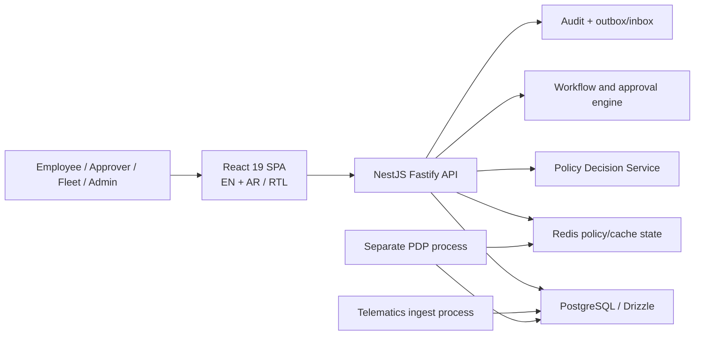
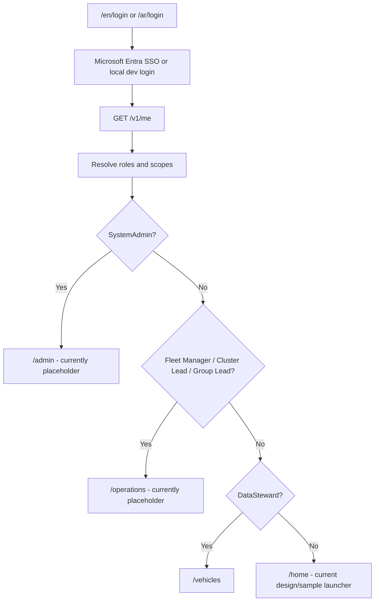
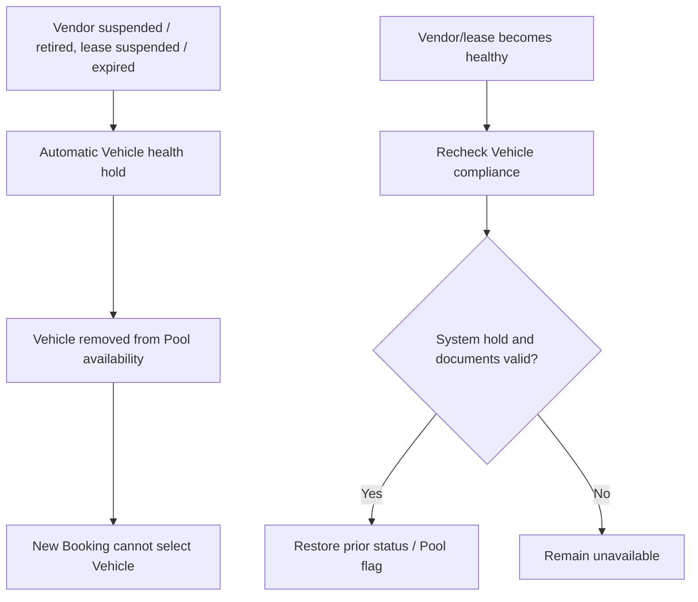
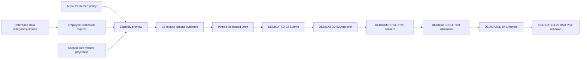
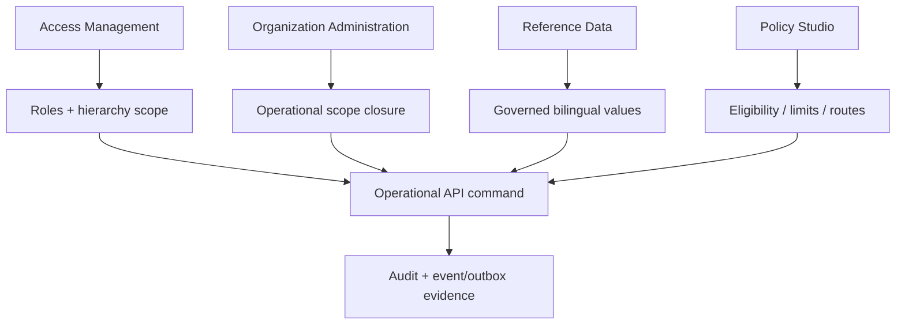

# Fleet Platform - Current Application, Roles and End-to-End Business Flow

> **Current-state date:** 2026-07-25  
> **Purpose:** One implementation-grounded view of what the application does today, how pages and business domains connect, who performs each responsibility, and what remains pending.  
> **Source of truth:** Current React routes/navigation, NestJS modules/controllers, executable implementation evidence, and the Fleet Operations Core status registers.  
> **Important interpretation:** A visible page, a backend API, and a production-ready business journey are different maturity levels. This document labels each separately.

## 1. Executive Picture

The Fleet Platform is a bilingual English/Arabic, hierarchy-scoped fleet operations application for AD Ports Group. It is designed to replace spreadsheet, email, and disconnected legacy processes across:

- Employee Pool Vehicle Booking.
- Dedicated Vehicle Entitlement requests.
- Booking approval and Fleet preparation.
- Vehicle onboarding and registry management.
- Vendor, document, and lease governance.
- Physical Vehicle handover and return.
- Reference data, organization hierarchy, access, and business-policy administration.
- Compliance, fines, telematics, dashboards, audit, and migration support.

The application is not uniformly complete. Its current maturity is:

| Area | Current position |
|---|---|
| Pool Booking search and Draft | Verified and connected to live APIs and PostgreSQL. |
| Pool Booking consent and submission | Technically implemented, including atomic consent and Booking number issuance. Production use remains fail-closed until approved EN/AR Legal/Privacy consent content is provisioned. A local-only demo path has completed the full flow. |
| Booking approval and Fleet preparation | API-backed and technically verified. Production creation of approvable Bookings inherits the consent-content gate. |
| Dedicated Vehicle request and eligibility | Verified through configured manual policies, secure eligibility evidence, Draft create/edit, and optional non-binding Vehicle preference. |
| Dedicated approval, consent, allocation, lifecycle, and BSD | Complete technical local/manual WithoutDriver flow: pinned approval, local-only governed consent, exclusive Fleet allocation, lifecycle, renewal, return, and confirmed BSD Pool windows. Production Legal consent and human UAT remain gates. |
| Vendor, documents, leases, and approval | Substantially implemented and API-backed, including maker-checker controls and Vehicle health propagation. External procurement/OCR/vendor-portal integrations remain future. |
| Vehicle registry and onboarding | Live API-backed list and onboarding. Import and several detailed lifecycle surfaces remain pending. |
| Handover and return | Rich UI prototype exists, but it currently uses local state and is not connected to the Handover APIs. |
| Reference Data, Access, Organization, and Policy administration | Live API-backed administration pages. |
| Operations dashboard, Compliance, Fines, and Live Map | Navigation routes are placeholders. Backend modules already exist but the operational pages are not implemented. |
| Home page | A design-system/sample launcher, not yet a role-specific operational dashboard. |

## 2. Application Architecture and Business-Control Model

### 2.1 Runtime Components

The monorepo contains:

- `app-ui`: React, Vite, Tailwind, shadcn/Radix, TanStack Query, React Router, and react-i18next.
- `app-api`: NestJS, Fastify, Drizzle, PostgreSQL, Redis, policy evaluation, workflow, audit, and messaging.
- Three backend deployables: main API, policy decision process, and telematics ingest process.
- Docker-based local PostgreSQL/TimescaleDB and Redis.

### 2.2 Three Authorization Layers

The real business authority does not come from hiding a menu item. It is enforced at three layers:

1. **Navigation visibility:** The sidebar shows only modules relevant to the signed-in roles.
2. **React route guards:** Direct browser navigation is role-guarded for the implemented operational and administration pages.
3. **Backend authority:** Controllers and services independently enforce authenticated Principal, role, organization, hierarchy scope, ownership, workflow assignment, and separation of duties.

Important backend rules include:

- The server-authenticated Principal is the acting authority; request bodies cannot choose the actor.
- Employee reads and writes are owner-bound.
- Fleet and approval work is hierarchy-scope-bound.
- Cross-organization reads and references are denied.
- System Administrator alone is not an operational Employee, Fleet Manager, approver, consent signer, or allocator.
- A maker/submitter cannot approve the same Vendor.
- A requester cannot approve their own workflow task.
- Delegation must be active, scope-valid, time-bounded, and one hop.
- Retryable commands use idempotency keys and optimistic revision checks.
- Audit and outbox evidence are written with the business mutation where implemented transactionally.

### 2.3 Shared Business Foundations

| Foundation | Business meaning | Consumers |
|---|---|---|
| Identity and Access | Links the signed-in account to a Person, roles, and effective scopes. | Every protected page and API. |
| Organization Hierarchy | Defines Group, Cluster, Pool, Location, or other configured levels and controls which records a role may see. | Vehicles, Bookings, approvals, preparation, policies, reports. |
| Reference Data | Provides bilingual governed dropdown values instead of hardcoded lists. | Vehicles, Vendors, Dedicated requests, configuration pages. |
| Policy Studio/PDP | Stores versioned facts and decision tables; evaluates eligibility, limits, routing, and defaults. | Booking, Dedicated Entitlement, Compliance, approval routing. |
| Workflow | Creates immutable approval instances and assigned/delegated work items. | Booking approval today; Dedicated approval next. |
| Vehicle Master | Supplies the physical asset, lifecycle, Pool assignment, documents, health, and hierarchy location. | Booking, Dedicated preference/allocation, Handover, Compliance, Telematics. |
| Audit and Messaging | Preserves who did what and publishes reliable domain events. | All material backend mutations. |

## 3. Sign-In, Landing and Navigation Flow

### 3.1 Entry Flow

### 3.2 Landing Gaps

- System Administrators land on `/admin`, which is currently a Coming Soon page; they must choose a real administration page from the sidebar.
- Fleet leadership lands on `/operations`, which is currently a Coming Soon page; live work is available through Approvals, Preparation, Vehicles, and other sidebar entries.
- Employees and most specialist roles land on `/home`, which currently links to design and sample screens rather than showing operational tasks.
- A role-specific actionable landing/dashboard is still required.

## 4. Page-by-Page Current State

Status definitions used below:

- **LIVE:** Connected to real API contracts and usable for its stated scope.
- **TECHNICAL / GATED:** Implemented and tested, but a production business/legal dependency prevents the complete production journey.
- **PARTIAL:** Some real behavior exists, but a material part of the page or journey remains incomplete.
- **PROTOTYPE:** Rendered interaction uses local/static state rather than the real business API.
- **PLACEHOLDER:** Route intentionally renders Coming Soon.
- **SUPPORT:** Development/design page, not an operational business page.

### 4.1 Authentication and General Pages

#### Login - `/:lang/login`

**Roles:** Public entry.  
**Status:** LIVE.  
**Business purpose:** Authenticate with Microsoft Entra ID. Local development can use seeded demo users.  
**Connection:** Successful login loads `/v1/me`, derives roles/scopes, then redirects to the role landing.  
**Pending:** Production identity depends on real Entra configuration and account-to-Person linkage.

#### Home - `/:lang/home`

**Roles:** Any authenticated user can reach it; it appears in Employee-family navigation.  
**Status:** SUPPORT, not an operational dashboard.  
**Current content:** Links to Design Showcase and Booking Sample.  
**Business connection:** None to live work queues or KPIs.  
**Pending:** Replace with a role-aware task dashboard: Employee upcoming Bookings/requests, Approver pending tasks, Fleet preparation/alerts, and Administration exceptions.

#### Design Showcase - `/:lang/design`

**Roles:** Any authenticated user through direct URL.  
**Status:** SUPPORT.  
**Purpose:** UI component/design reference. It must not be treated as a business module.

#### Booking Sample - `/:lang/book-sample`

**Roles:** Any authenticated user through direct URL.  
**Status:** SUPPORT.  
**Purpose:** Visual sample only. The live Booking route is `/booking`.

### 4.2 Employee Pool Booking

#### Book a Vehicle / My Bookings - `/:lang/booking`

**Roles:** Employee, Substitute Driver, Professional Driver.  
**Status:** LIVE for search and Draft; TECHNICAL/GATED for production consent and submit.  

**What the page does:**

1. Loads the authenticated Employee Booking context and governed Pool scope.
2. Captures destination, date/time window, and passenger count.
3. Loads a privacy-safe availability timeline. Other people's Booking details are not exposed.
4. Queries Vehicles that are active, Pool-enabled, in scope, compliant, large enough, and not overlapping another active reservation.
5. Allows review and idempotent Draft creation.
6. Shows the Employee's own Bookings.
7. Contains the consent, submission, reconciliation, confirmation, and calendar-download UI.

**Principal APIs:**

- `GET /v1/bookings/context`
- `GET /v1/vehicles/availability-timeline`
- `GET /v1/vehicles/available`
- `POST /v1/bookings`
- `GET /v1/bookings`
- `GET /v1/bookings/:id`
- `POST /v1/bookings/:id/consent`
- `POST /v1/bookings/:id/submit`

**Business rules connected to this page:**

- Vehicle lifecycle, Pool flag, hierarchy assignment, capacity, buffered overlap, compliance, and Vendor/lease health determine availability.
- Draft retries keep the same idempotency key.
- Consent is server-versioned and revalidates the driver, eligibility, Vehicle, and reservation.
- Consent, Booking number, reservation, audit, event, outbox, and command completion are atomic in the technical baseline.
- Production consent remains disabled until approved Legal/Privacy EN/AR content and governed source are configured.
- On-behalf Fleet Booking is not enabled; `/bookings/create` remains a placeholder.

**Next page when the flow proceeds:** Booking Approval Inbox after successful submission creates assigned workflow tasks.

### 4.3 Booking Approval and Preparation

#### Booking Approval Inbox - `/:lang/approvals`

**Roles:** Approver, Delegate, Fleet Manager, Cluster Fleet Lead, Group Fleet Lead.  
**Status:** TECHNICAL/GATED. API-backed and verified; production work-item creation depends on the Booking consent gate.  

**What the page does:**

- Lists only workflow tasks assigned to the actor or validly delegated to them.
- Displays requester, Vehicle, period, passengers, purpose, consent, conflict, and SLA evidence.
- Supports Approve, Request Changes, and Decline.
- Requires a reason for non-approval outcomes.
- Handles stale workflow/Booking conflicts and refreshes the queue.

**Principal APIs:**

- `GET /v1/booking-approvals`
- `POST /v1/bookings/:id/approve`
- `POST /v1/bookings/:id/decline`
- `POST /v1/bookings/:id/request-changes`

**Business connection:** An approved task moves the Booking into the Fleet preparation population. Request Changes returns responsibility to the Employee. Decline closes the approval route according to the workflow state.

#### Booking Preparation - `/:lang/booking-preparation`

**Roles:** Fleet Manager, Cluster Fleet Lead, Group Fleet Lead.  
**Status:** LIVE read-only queue.  

**What the page does:** Shows scoped approved Bookings awaiting physical Handover, including Booking number, Vehicle, time window, and location.  
**API:** `GET /v1/booking-preparation`.  
**Business connection:** This page is the bridge between approval and the physical release process.  
**Pending:** Add an explicit action/link into a real Booking-bound Handover page, preparation checklist, readiness status, and exception handling.

### 4.4 Handover and Return

#### Handover and Return - `/:lang/handover`

**Intended roles:** Fleet Manager, Cluster Fleet Lead, Group Fleet Lead.  
**Current route reality:** Any authenticated user can directly reach the route because it lacks a React `RequireRole` wrapper. The sidebar shows it only to Fleet roles.  
**Status:** PROTOTYPE.  

**What is rendered:**

- Handover/Return mode.
- Vehicle condition checklist.
- Fuel and odometer capture.
- Key confirmation.
- Damage markers and photos.
- Signature capture.
- Local confirmation/toast behavior.

**What is not connected:** The page uses hardcoded/local state and does not call the Handover API. It is not selected from a real preparation work item and does not persist evidence.  

**Existing backend APIs:**

- `POST /v1/handovers`
- `GET /v1/handovers/:id`
- `POST /v1/handovers/:id/return`
- `POST /v1/handovers/:id/damage`
- `GET /v1/vehicles/:id/keys`

**Pending:** Add Fleet route guard, connect a preparation item/Booking/Vehicle, persist release/return evidence, enforce exactly-once race behavior, and complete the Booking state transition.

### 4.5 Dedicated Vehicle Entitlement

#### Dedicated Vehicle Request / My Requests - `/:lang/dedicated-vehicle`

**Roles:** Employee, Professional Driver.  
**Status:** LIVE for configured eligibility and Draft.  

**What the page does:**

1. Loads authenticated requester, organization location, and capability gates.
2. Selects Long Term or Temporary and Without Driver. With Driver is deliberately disabled.
3. Loads bilingual justification categories and Vehicle classes from Reference Data.
4. Calls the configured Dedicated eligibility policy using authoritative Person and request facts.
5. Displays ALLOW/DENY reasons and permitted classes.
6. Returns only Employee-safe, scoped, currently eligible Vehicle options.
7. Allows an optional preferred Vehicle and optional 500-character preference note.
8. Saves or revision-safely edits the owner's Draft.
9. Lists the Employee's own Dedicated requests.

**Principal APIs:**

- `GET /v1/entitlements/context`
- `GET /v1/entitlements/justification-categories`
- `GET /v1/entitlements/vehicle-classes`
- `POST /v1/entitlements/eligibility-preview`
- `POST /v1/entitlements`
- `GET /v1/entitlements`
- `PATCH /v1/entitlements/:id`

**Business rules connected to this page:**

- Reference Data supplies manually maintainable D3 categories and Vehicle classes.
- Policy Studio supplies manually maintainable D8 direct-fact rules and deny-by-default behavior.
- Preview evidence expires after 15 minutes and is bound to organization, requester, location, request fingerprint, policy version, permitted classes, and eligible Vehicle IDs.
- The browser cannot forge eligibility or a preferred Vehicle.
- The preferred Vehicle is non-binding and creates no hold or allocation.
- Vehicle options exclude wrong-scope, inactive, non-Pool, health-held, overlapping, or document-expiring Vehicles.
- Material request changes invalidate the preview and selected Vehicle.

**Connected pages now implemented:** Unified Approval Inbox, assigned-driver consent in My Requests, Fleet Dedicated Allocation/variance, lifecycle actions, and Fleet BSD proposal/confirmation with automatic activation/restoration.

### 4.6 Vehicle Management

#### Vehicle Registry - `/:lang/vehicles`

**Roles:** Fleet Manager, Cluster Fleet Lead, Group Fleet Lead, Data Steward.  
**Status:** LIVE list; PARTIAL lifecycle/detail journey.  

**What the page does:**

- Loads the hierarchy-scoped Vehicle registry.
- Searches by plate, make/model, or organization node.
- Shows lifecycle/operational status, GPS state, Mulkiya, insurance, and summary counts.
- Links to Vehicle onboarding and import.

**API:** `GET /v1/vehicles`.  
**Business connection:** Vehicle status and evidence feed Booking availability, Dedicated preferences, Handover, Compliance, Vendor health, and Telematics.  
**Pending:** Row-to-detail/quick-view workflow, richer update/transition/document/history actions, and the import page.

#### Vehicle Onboarding - `/:lang/vehicles/onboard`

**Roles:** Fleet Manager, Cluster Fleet Lead, Group Fleet Lead, Data Steward.  
**Status:** LIVE for manual onboarding.  

**What the page does:** Captures acquisition scenario, Vendor/lease where applicable, identity, make/model/class, Pool assignment, hierarchy location, compliance dates, and review before creation.  
**API:** `POST /v1/vehicles`, plus live lookup and Vendor/lease reads.  
**Business rules:** Owned Vehicles cannot carry Vendor/lease references; leased Vehicles require valid active Vendor/lease relationships; onboarding data determines later Pool and compliance eligibility.  
**Future integrations shown honestly:** VIN decoding and external source automation remain disabled/future.

#### Vehicle Import - `/:lang/vehicles/import`

**Roles:** Fleet Manager, Cluster Fleet Lead, Group Fleet Lead, Data Steward.  
**Status:** PLACEHOLDER.  
**Backend capability:** Import create/status/rows/resolve/sign-off APIs exist for Data Steward/System Admin.  
**Pending:** File upload, validation preview, row-resolution, and sign-off UI.

### 4.7 Vendor and Lease Management

#### Vendors and Leases - `/:lang/admin/vendors-leases`

**Roles:** System Admin, Procurement, Data Steward.  
**Status:** LIVE and API-backed for the implemented manual-source lifecycle.  

**What the page does:**

- Vendor master list and detail drawer.
- Five-step persisted onboarding flow.
- Versioned Vendor document evidence and confirmation/rejection/supersession.
- Lease contract list and creation.
- Procurement approval inbox.
- Submit, approve, reject, request changes, suspend, reactivate, and retire.
- Integrated-source records are read-only.

**Principal APIs:** `/v1/vendors`, `/v1/vendors/approvals`, Vendor onboarding, documents, lifecycle actions, and lease-contract endpoints.  

**Business rules connected to other modules:**

- Required Vendor documents must be confirmed and current before activation.
- Maker/submitter self-approval is denied.
- Leased Vehicle onboarding consumes only valid active Vendors and usable leases.
- Vendor or lease deterioration automatically places linked Vehicles on health hold and removes them from Pool availability.
- Healthy remediation restores only system-created holds and only when Vehicle compliance remains valid.
- Booking consumes Vehicle health/bookability, not Vendor commercial or banking data.

**Pending:** External Procurement/Oracle provider settings, OCR, Vendor portal, AP integration, scorecard, and full off-hire automation. Manual operation remains the working fallback.

### 4.8 Reference Data

#### Lookup Management - `/:lang/admin/reference-data`

**Roles:** Data Steward, System Admin.  
**Status:** LIVE.  

**What the page does:** Creates and maintains bilingual lookup types/values, hierarchy relationships, status, ordering, import, and export.  
**Business connection:** These values populate governed dropdowns across Vehicle, Vendor, Dedicated Vehicle, and other modules. Dedicated justification categories and Vehicle classes are maintained here.  
**Control:** Changes are backend-authorized and audited; system/reference constraints prevent arbitrary operational bypass.

### 4.9 User and Access Administration

#### Users and Access - `/:lang/admin/access`

**Roles:** System Admin.  
**Status:** LIVE.  

**What the page does:**

- User directory and status summary.
- Person role assignments at a selected hierarchy scope.
- Role revocation.
- Account suspension/reactivation.
- Access-review reporting and CSV export.

**Business connection:** Every operational page and API ultimately depends on these role/scope assignments. Assigning `FleetManager` at one Pool does not grant Group-wide Fleet access.  
**Important rule:** A System Admin can administer authority but does not automatically gain operational authority.

### 4.10 Organization Administration

#### Organization Hierarchy - `/:lang/admin/organization`

**Roles:** System Admin.  
**Status:** LIVE and API-backed.  

**What the page does:** Manages hierarchy levels and nodes, node details, impact analysis, movement, retirement/reactivation, history, and quality.  
**Business connection:** Hierarchy nodes define the scope of Vehicles, Fleet users, approval work, policy overrides, and reporting. Moving or retiring a node can affect many operational records, so impact/revision checks are required.

### 4.11 Policy Administration

#### Policy Studio - `/:lang/admin/policy`

**Roles:** System Admin.  
**Status:** LIVE and API-backed.  

**What the page does:**

- Lists configured policy rule types and active versions.
- Selects organization-default or hierarchy-scoped policy authority.
- Authors typed conditions and ALLOW/DENY/VALUE/ROUTE outcomes.
- Saves revision-controlled Drafts.
- Simulates rules before activation.
- Activates immutable versions.
- Supports Dedicated eligibility output JSON such as permitted Vehicle classes and duration limits.

**Business connection:** Policy changes alter application decisions without React or service-code changes. The current Dedicated flow reads the active policy and fails closed when no rule permits the request.  
**Control:** A mandatory default outcome prevents undefined behavior; conservative policies use DENY by default.

### 4.12 Current Placeholder Routes

| Route | Visible to | Existing backend connection | What remains |
|---|---|---|---|
| `/operations` | Approver, Delegate, Fleet leadership | Operations overview and dashboard endpoints exist. | Build the role-scoped operational dashboard. |
| `/bookings/create` | Fleet leadership | Booking services exist, but on-behalf authority remains gated. | Close beneficiary/scope/idempotency authority and build Fleet creation UI. |
| `/compliance` | Fleet leadership | Eligibility, expiries, blocks, and lift APIs exist. | Build alert/worklist and remediation UI. |
| `/fines` | Fleet leadership | Fine, accident, recovery, substitution, and overdue enforcement APIs exist. | Build Fine/accident lifecycle pages and specialist actions. |
| `/live-map` | Fleet leadership | Devices, trips, live telemetry, and alert APIs exist. | Build map, filters, alerts, and trip detail. |
| `/admin` | System Admin | Administration subpages exist. | Build a useful Admin landing page. |
| `/admin/integrations` | System Admin | Adapter seams exist in several domains. | Build configuration/health UI only when providers are real; preserve manual fallback. |

## 5. Role-by-Role Responsibilities and Pages

### 5.1 Employee

**Real business responsibility:** Request transport needed for work, provide accurate trip/justification facts, consent where required, and track own requests.  
**Pages:** Home, Book a Vehicle, Dedicated Vehicle.  
**Can do now:** Search Pool availability, create a Booking Draft, view own Bookings, run Dedicated eligibility, save/edit own Dedicated Draft.  
**Gated/pending:** Production Booking consent/submit; Booking changes/extensions/cancellation completion; Dedicated submit/approval/consent/allocation/lifecycle.

### 5.2 Substitute Driver

**Real business responsibility:** Drive temporarily during a governed substitution window.  
**Pages:** Home and Book a Vehicle.  
**Current limitation:** The page is visible, but a complete substitution/on-behalf user journey is not delivered. Substitution-window backend capability exists under Fines/driver governance.

### 5.3 Professional Driver

**Real business responsibility:** Operate Vehicles where a professional driver is assigned.  
**Pages:** Home, Book a Vehicle, Dedicated Vehicle.  
**Current limitation:** Dedicated `WithDriver` requests are disabled until the professional-driver policy and later consent/allocation phases are complete.

### 5.4 Approver

**Real business responsibility:** Review assigned requests using policy, consent, conflict, purpose, and SLA evidence; approve, decline, or request correction.  
**Pages:** Approval Inbox; Operations placeholder.  
**Control:** Cannot approve own request and cannot act outside assigned workflow authority.

### 5.5 Delegate

**Real business responsibility:** Temporarily perform an approver's tasks under an explicit delegation.  
**Pages:** Approval Inbox; Operations placeholder.  
**Control:** Delegation is organization/type/window/one-hop constrained; it is not a general role escalation.

### 5.6 Fleet Manager

**Real business responsibility:** Operate one authorized Pool/location: Vehicle readiness, Booking decisions where assigned, preparation, handover, compliance, fines, and monitoring.  
**Live pages:** Approvals, Booking Preparation, Vehicle Registry, Vehicle Onboarding.  
**Prototype:** Handover.  
**Placeholders:** Operations dashboard, Fleet create Booking, Compliance, Fines, Live Map, Vehicle Import.

### 5.7 Cluster Fleet Lead

**Real business responsibility:** Same operational domains as Fleet Manager across a wider Cluster scope.  
**Pages:** Same Fleet pages.  
**Difference:** Backend hierarchy closure determines wider visibility; the UI role name alone does not bypass scope.

### 5.8 Group Fleet Lead

**Real business responsibility:** Group-wide operational oversight and intervention.  
**Pages:** Same Fleet pages.  
**Difference:** Expected root/group scope and wider queues, still subject to explicit role assignment.

### 5.9 Cluster CEO

**Real business responsibility:** Executive approval in Dedicated Vehicle routes where policy requires it.  
**Current page coverage:** No dedicated Entitlement approval page/navigation is implemented. The role currently lands on generic Home.  
**Pending:** DEDICATED-02 inbox, immutable route, decision, delegation, and race handling.

### 5.10 Procurement

**Real business responsibility:** Govern Vendor onboarding, evidence, leases, maker-checker approval, and lifecycle.  
**Page:** Vendors and Leases.  
**Can do now:** Use the manual Vendor/lease/document lifecycle and approval inbox.  
**Pending:** External Procurement integration, Vendor portal, OCR, AP, scorecard/off-hire automation.

### 5.11 Data Steward

**Real business responsibility:** Maintain controlled master/reference data and support clean migration/onboarding data.  
**Pages:** Vehicle Registry, Vehicle Onboarding, Vehicle Import placeholder, Vendors and Leases, Reference Data.  
**Can do now:** Maintain lookups, onboard Vehicles, and manage permitted Vendor data.  
**Pending:** Vehicle Import UI and broader data-quality workbench.

### 5.12 System Administrator

**Real business responsibility:** Administer accounts, roles, hierarchy, application configuration, and policy; not perform operational Fleet work merely because they are an administrator.  
**Pages:** Admin placeholder, Access, Organization, Policy Studio, Vendors and Leases, Reference Data, Integrations placeholder.  
**Important separation:** No Employee Booking, Booking Approval, Fleet allocation, or Handover authority is implied by this role alone.

### 5.13 Finance

**Real business responsibility:** Financial recovery, cost visibility, and accident/fine financial actions.  
**Current page coverage:** No Finance-specific page or navigation is implemented. Some Fines APIs permit Finance actions.  
**Pending:** Finance recovery worklist, cost visibility, and integrations.

### 5.14 HR

**Real business responsibility:** Employee facts, employment status, grade, driver/substitution governance, and HR consequences.  
**Current page coverage:** No HR-specific page is implemented. Person facts currently support policy evaluation; external HCM remains optional/future with application data as fallback.  
**Pending:** HR exception/worklist and governed integration status.

### 5.15 HSE

**Real business responsibility:** Safety and black-point/compliance governance.  
**Current page coverage:** No HSE page is implemented. Backend overdue black-point enforcement includes HSE authority.  
**Pending:** HSE worklist and evidence views.

### 5.16 Insurance Lead

**Real business responsibility:** Insurance validity, claims, and accident evidence.  
**Current page coverage:** No Insurance-specific page is implemented. Vehicle insurance dates already affect bookability and Dedicated preference eligibility.  
**Pending:** Policy/claim workbench.

### 5.17 Internal Audit

**Real business responsibility:** Read-only audit, exception, access, and control review.  
**Current page coverage:** No audit console route is implemented even though audit and exception APIs exist.  
**Pending:** Read-only audit/search/export page with strict evidence masking.

### 5.18 Executive

**Real business responsibility:** Aggregate operational and utilization oversight without unnecessary personal detail.  
**Current page coverage:** No Executive dashboard is implemented. Dashboard APIs exist.  
**Pending:** Aggregate, scope-aware dashboards and privacy-safe drill-down.

## 6. End-to-End Business Connections

### 6.1 Vendor to Vehicle to Booking to Handover

```mermaid
flowchart LR
  Vendor["Vendor onboarding"] --> Docs["Required documents confirmed"]
  Docs --> Approval["Separate Procurement approval"]
  Approval --> Lease["Usable lease contract"]
  Lease --> Vehicle["Vehicle onboarding"]
  Vehicle --> Registry["Active scoped Vehicle registry"]
  Registry --> Availability["Booking availability"]
  Availability --> Draft["Employee Booking Draft"]
  Draft --> Consent["Consent + submit + Booking number"]
  Consent --> Inbox["Assigned approval inbox"]
  Inbox --> Prep["Fleet preparation queue"]
  Prep --> Handover["Physical Handover"]
  Handover --> Return["Return / damage / reconciliation"]
```

Business connections:

1. Procurement/Data Steward creates the Vendor and confirms required documents.
2. A separate Procurement authority approves the Vendor.
3. A lease can be created for an active Vendor.
4. Fleet/Data Steward onboards the Vehicle against the Vendor/lease when leased.
5. The Vehicle becomes available only when lifecycle, Pool flag, scope, compliance, health, capacity, and time-overlap rules pass.
6. Employee creates the Booking Draft.
7. Governed consent and submit atomically reserve the Vehicle and issue the Booking number.
8. Workflow assigns approval work by configured route/scope.
9. Approval moves the Booking into Fleet preparation.
10. Handover transfers physical custody and starts the trip.
11. Return records condition/damage and completes reconciliation.

Current breakpoints:

- Production consent content/source is not approved.
- Handover UI is not API-connected.
- My Bookings change lifecycle and Booking completion remain future phases.

### 6.2 Vendor/Lease Health Back into Booking

This connection prevents a commercially or operationally unhealthy leased Vehicle from remaining bookable. Booking sees only Vehicle health/bookability, not Vendor banking, documents, or commercial terms.

### 6.3 Dedicated Vehicle Request to Future Allocation

Current working boundary ends at pinned Draft. The Employee's preferred Vehicle is evidence of preference only. Fleet must requalify availability and exclusivity before final allocation and may select a different permitted Vehicle with a governed variance reason.

### 6.4 Administration to Operational Decisions

This is how administration connects to real business behavior:

- Access decides **who** may act.
- Organization decides **where** they may act.
- Reference Data decides **which controlled values** can be selected.
- Policy decides **whether and how** a request proceeds.
- Domain services own the actual Booking, Entitlement, Vehicle, Vendor, or Handover state.
- Audit/outbox records **what happened** and supports downstream integration.

## 7. Backend Capabilities Without Completed Pages

| Backend domain | Implemented capability | Frontend status |
|---|---|---|
| Compliance | Eligibility checks, expiry reads, blocks, block creation/lifting. | `/compliance` placeholder. |
| Fines and Accidents | Fine/accident capture, recovery, substitution windows, overdue black-point enforcement. | `/fines` placeholder; no specialist Finance/HSE pages. |
| Telematics | Device registry/pairing, trips, live Vehicle telemetry, alerts/acknowledgement. | `/live-map` placeholder. |
| Dashboards | Operations overview, utilization, fines per user, compliance heat map, Entitlement inventory, telematics coverage. | `/operations` placeholder; no Executive dashboard. |
| Migration/Import | Import create/status/rows/resolve/sign-off. | Vehicle Import placeholder. |
| Audit/Exceptions | Audit and exception-report endpoints. | No Internal Audit page. |
| Geocoding | Search and reverse-geocode endpoints. | Used as a service seam; no dedicated page. |
| Notifications | Backend notification foundation. | No notification center workflow documented as complete. |
| Dedicated lifecycle | Submit/approve/decline/consent/allocate/BSD/cancel endpoint shapes exist. | Deliberately fail closed until DEDICATED-02 onward. |

An existing endpoint is not evidence that its full business process is production-ready. Each pending page still requires role/scope UX, state/error handling, tests, accessibility, and end-to-end evidence.

## 8. External Integrations and Manual Alternatives

The application policy is that an unavailable integration must not stop the core business where safe manual operation is possible.

| Integration area | Current approach | Manual/application alternative |
|---|---|---|
| Oracle Fusion HCM | Production adapter is future/stub. | Person, grade, employment status, manager, and scope data in the application support current policy evaluation and dev/test operations. |
| External Procurement/Vendor source | Future provider seam; Integrated Vendors are read-only. | Full manual Vendor, document, approval, and lease pages are implemented. |
| OCR/document extraction | Future. | Users manually register opaque document references and authorized staff confirm/reject evidence. |
| VIN decoding | Future. | Vehicle identity is manually entered and governed by validation/lookups. |
| External policy source | Not required for Dedicated baseline. | Policy Studio is the manual authoritative rule administration page. |
| External master data | Optional future synchronization. | Reference Data is the manual authoritative bilingual administration page. |
| Production consent content | Awaiting Legal/Privacy governed source. | Local-only dummy content supports demonstrations; production remains correctly fail closed because legal consent cannot be invented manually by developers. |
| Telematics provider | External provider future. | Simulator/ingest foundation supports Phase 1 technical operation. |

## 9. Implemented, Partial and Pending Inventory

### 9.1 Verified or Substantially Implemented

- Principal-bound authentication, roles, and hierarchy scopes.
- EN/AR locale routing and RTL application shell.
- Manual Reference Data administration.
- User/access and organization hierarchy administration.
- Versioned Policy Studio with simulation and activation.
- Vendor master, onboarding, documents, approval, leases, lifecycle, and linked Vehicle health propagation.
- Vehicle registry and manual onboarding.
- Pool Booking context, privacy-safe availability, eligible Vehicle search, and idempotent Draft.
- Technical Booking consent/submit/number/reservation transaction.
- Booking approval inbox and Fleet preparation queue.
- Dedicated configured eligibility, safe preference options, opaque evidence, and Draft create/edit/My Requests.
- Backend foundations for Compliance, Fines, Telematics, Dashboards, Audit, Imports, Workflow, and Messaging.

### 9.2 Partial or Gated

- Production Booking consent and complete submit journey: blocked by approved Legal/Privacy content/source.
- Booking approval/preparation: technically ready but production work-item creation inherits the consent gate.
- Vehicle Management: registry/onboarding live; detail/lifecycle/import surfaces incomplete.
- Handover: business-rich UI prototype but no real API persistence.
- Home, Admin landing, and Operations landing: not actionable dashboards.
- Notifications and operational exception handling: foundations exist, complete user journeys do not.

### 9.3 Pending Core Business Work

1. DEDICATED-02: submit and immutable approval workflow/inbox.
2. DEDICATED-03: assigned-driver consent and exclusive Fleet allocation.
3. DEDICATED-04: modification, renewal, cancellation, return, and expiry.
4. DEDICATED-05: BSD scheduling and temporary Pool restoration.
5. BOOKING-04: owner My Bookings change lifecycle.
6. BOOKING-05: API-connected, atomic Handover/Return and Booking completion.
7. Vehicle detail, lifecycle, compliance evidence, custody, and import UI completion.
8. Operations, Compliance, Fines, Live Map, Audit, Executive, Finance, HR, HSE, and Insurance pages.
9. Role-specific operational landing pages.
10. Production integrations, observability/runbooks, load/security/accessibility hardening, UAT, pilot, and release.

## 10. Known Gaps and Risks

| Priority | Gap or risk | Business effect | Required action |
|---|---|---|---|
| Critical production gate | No approved governed EN/AR Booking consent content. | Production Booking cannot safely issue final consent/Booking number. | Legal/Privacy approval and immutable source/version provisioning. |
| High | Handover page is local-only and lacks a Fleet route guard. | Rendered actions do not persist; direct authenticated access is broader than intended. | Add `RequireRole`, connect preparation item and Handover APIs, then prove exactly-once release/return. |
| High | Dedicated approval/consent/allocation does not exist as a live journey. | Dedicated process stops at Draft. | Execute DEDICATED-02 and DEDICATED-03. |
| High | Several specialist roles have no pages. | Finance, HR, HSE, Insurance, Internal Audit, Executive, and Cluster CEO cannot complete role-specific work in the UI. | Build prioritized worklists based on real backend contracts. |
| Medium | Home/Admin/Operations landing pages are not operational. | Users must know which sidebar module to choose; no consolidated task picture. | Build role-aware landing cards and counters from live APIs. |
| Medium | Vehicle Import is a placeholder despite backend import APIs. | Bulk onboarding remains operationally incomplete. | Implement validate/resolve/sign-off UI. |
| Medium | Dedicated preview evidence has no retention job yet. | Preview rows will grow over time. | Add scheduled cleanup with operational metrics before production scale. |
| Closed | Full frontend MSW/base-URL mismatch previously made the whole-suite signal noisy. | Test-only API base normalization and deterministic worker capacity restored strict regression coverage. | Full frontend now passes 23 files / 107 tests; strict unhandled-request errors remain enabled. |
| Medium | External adapters remain future. | Manual work continues and synchronization is not automatic. | Add provider configuration/health only alongside tested manual fallback and reconciliation. |

## 11. Recommended Completion Sequence

The following order preserves the real business dependencies:

1. **Close Booking Legal consent provisioning.** This unlocks the already-built submit, approval, and preparation chain for production.
2. **Implement DEDICATED-02.** Add idempotent submit, immutable route lineage, scoped approval inbox, SoD, delegation, and race handling.
3. **Connect Handover end to end.** Route from Preparation into a Booking-bound Handover, persist release/return, and complete Booking state atomically.
4. **Implement DEDICATED-03.** Add assigned-driver consent, final requalification, exclusive allocation, and preference-variance evidence.
5. **Complete Employee lifecycle pages.** My Bookings changes and Dedicated modification/renewal/cancel/return.
6. **Complete Vehicle operational surfaces.** Detail, transitions, documents, history, custody, and import.
7. **Build role worklists.** Compliance, Fines, Live Map, Audit, Finance/HR/HSE/Insurance, and Executive dashboards.
8. **Replace generic landing pages.** Give each role immediate tasks, alerts, upcoming work, and governed metrics.
9. **Integrate external providers behind existing ports.** Keep the manual pages as tested fallback and add reconciliation/health indicators.
10. **Run release hardening.** Full test signal, accessibility, performance, security, recovery, retention, UAT, pilot, runbooks, and cutover.

## 12. Source Map

The most important implementation sources for validating this document are:

- React route authority: `app-ui/src/app/routing/router.tsx`
- Role-based sidebar: `app-ui/src/app/shell/nav.ts`
- Landing selection: `app-ui/src/features/auth/landing.ts`
- Platform roles: `app-ui/src/features/auth/roles.ts`
- Frontend pages: `app-ui/src/features/`
- Backend composition: `app-api/src/app.module.ts`
- Backend controllers: `app-api/src/modules/*/controllers/`
- Shared API contracts: `app-api/src/contracts/`
- Fleet delivery status: `docs/05-implementation/orchestration/fleet-operations-core/MASTER-STATUS.md`
- Implementation evidence: `docs/05-implementation/orchestration/fleet-operations-core/EVIDENCE-REGISTER.md`
- Dedicated phase plan: `docs/05-implementation/orchestration/fleet-operations-core/dedicated-vehicle-implementation-plan/`
- Booking phase plan: `docs/05-implementation/orchestration/fleet-operations-core/booking-core-implementation-plan/`

## 13. Bottom Line

The platform already has a strong governed core: identity/scope, Vendor and Vehicle governance, live Pool search/Draft, technical Booking consent/approval/preparation, configurable Dedicated eligibility/Draft, and real administration pages. The largest remaining work is not basic scaffolding. It is completing the connected operational lifecycles after Draft/approval boundaries, wiring Handover, giving specialist roles their pages, closing the production Legal consent gate, and converting backend-only modules into usable worklists and dashboards.

The real business model is connected as follows:

> Administration defines people, scope, controlled values, and policies. Vendor and Vehicle governance establish trustworthy assets. Employees create Pool Booking or Dedicated Entitlement demand. Workflow assigns accountable approvers. Fleet prepares, allocates, and transfers physical custody. Compliance, Telematics, Fines, Audit, and reporting observe and govern the lifecycle. Every external integration must plug into this model without removing the manual operational fallback.