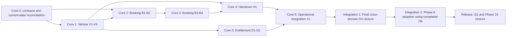

# Fleet Operations Core - Orchestration Master Status

| Field | Value |
|---|---|
| Objective | Deliver the real-time fleet operational core from `docs/implementation-plan/booking_and_vehiclemanagement/`, then wire the full Organization, Decision and Workflow platforms into proven domain journeys. |
| Orchestrator | Delivery Orchestrator |
| Baseline | Current repository through migration `0055`; Booking, Handover and Dedicated flows use an application-owned immutable bilingual consent registry with maker-checker activation. |
| Updated | 2026-07-30 |
| Overall status | `ACTIVE` |
| Current authorization | Approved Vendor, Vehicle, Booking and Handover mockups may be implemented inside the existing shell with EN/AR parity; unavailable integrations remain explicitly future. |
| Live role alignment | Employee Booking, Approver/Delegate/Fleet approval inbox, Fleet preparation and SystemAdmin denial are aligned across navigation, route guards and current API on ports `5173/3000`. |
| Local demo mode | `pnpm dev:bootstrap` applies migrations, editable hierarchy/people/roles/reference data, API-created demo fleet, governed consent v3 and editable development policy v2. Fleet on-behalf and Dedicated WithDriver are active from persisted records. |
| Next action | Continue INT-1 cross-domain O4 closure after verified effective-time authority and Fine/Compliance/Audit tenant-isolation slice; complete Vehicle, Booking, Handover, Entitlement, Dashboard, Workflow and Policy negative matrix. |

## 1. Controlled Sequencing Decision

The delivery backbone is the Booking and Vehicle Management program because Vehicle, Pool Booking, Handover and Dedicated Entitlement own the operational records and user journeys. Cross-cutting Organization, Policy and Workflow platforms must integrate through stable domain contracts; they do not replace the domain modules.

O6 remains completed foundation evidence and is not reopened. Broad O4 domain query propagation is delivered just in time for each core read/mutation path, then receives a final cross-domain closure gate after the operational core stabilizes. This sequencing must not be interpreted as permission to postpone basic authorization or organization integrity.

### Minimum authorization floor before any live mutation

1. The authenticated actor is server-bound; request bodies cannot choose the acting identity.
2. Every operational resource persists organization and either its effective scope identifier or immutable event-time scope evidence. Booking persists actor/beneficiary/driver/scope evidence for self and Fleet-managed Drafts.
3. Cross-organization references and access are denied at API and database boundaries.
4. Employee self-service is ownership-bound; on-behalf operations require an explicit operational role and bounded provisional scope.
5. System Administrator alone cannot perform operational booking, approval, allocation or handover actions.
6. Actor, beneficiary/requester, driver, approver, allocator and handover actor remain distinct in audit evidence.
7. No phase may claim multi-organization or full N-level scope readiness until the later O4/O6 integration gate passes.

## 2. Delivery Order

## 3. Wave Status

| ID | Outcome | Included program phases | Status | Dependencies | UI/mockup gate | Exit evidence |
|---|---|---|---|---|---|---|
| CORE-0 | Reconcile current implementation and freeze shared domain ports/contracts without reimplementing existing foundations | 0-1 | `ACTIVE` | Current repository baseline | N/A | Current-state matrix; stable IDs/states/reason codes; ownership map; focused red/green baseline |
| CORE-1 | Operational Vehicle Management: onboarding/import, registry/detail, lifecycle/pool controls, documents/compliance/device/custody | V1-V4 (5-8) | `ACTIVE_PARTIAL` | CORE-0 | Approved | Onboarding and scoped registry verified; full detail/quick view, import and later lifecycle surfaces remain |
| CORE-2 | Basic live Pool Booking: self authority, availability, eligibility, consent and submit | B1-B2 (9-10) | `VERIFIED_DEVELOPMENT_ACTIVE` | Target-environment consent activation for release | Approved for derived implementation | Self and scoped Fleet-managed Draft flows live; selected driver owns consent |
| CORE-3 | Booking operations: approval/preparation queue, My Bookings, modify/re-consent, extend/cancel/complete | B3-B4 (11-12) | `VERIFIED` | Human UAT/pilot | Approval/delegation/preparation and My Bookings implemented EN/AR | Actor/SoD/state/idempotency and role journeys verified |
| CORE-4 | Physical handover/return, condition, damage, odometer/fuel, keys and accountability | H1 (16) | `VERIFIED_HAPR_00_07_COMPLETE` | Production storage adapter and release evidence | Screens `25`-`28` and demo composition verified | Atomic lifecycle/replay, immutable evidence, register, capture, chain/receipt/amendments and approval projection verified |
| CORE-5 | Dedicated entitlement request, approval, consent, allocation and BSD; active pack: [Dedicated Vehicle Implementation Plan](dedicated-vehicle-implementation-plan/README.md) | D1-D2 (14-15) | `VERIFIED_DEVELOPMENT_ACTIVE` | Target-environment configuration and release evidence | Dedicated journey implemented EN/AR; editable roster/policy/reference/leave sources | WithoutDriver lifecycle plus roster/policy-bound WithDriver Draft verified |
| CORE-6 | Notifications, reporting, audit, imports and operational readiness across proven journeys | X1 (17) | `LIVE_OPERATIONS_AND_DEDICATED_HANDOFF_VERIFIED` | Remaining domain waves and human Dedicated production gates | Operations/report mockups approved | Live EN/AR role-aware operations, tenant-safe aggregates, Dedicated inventory/reconciliation/events and handoff verified; wider cross-domain CORE-6 remains active |
| INT-1 | Close the final cross-domain O4 query-propagation matrix after each core phase delivers its just-in-time O4 controls | Organization O4 | `ACTIVE_PARTIAL` | CORE-6 operational contracts stable | Organization administration UI evidence only if changed | Effective-time roles/nodes and Fine/Compliance/Audit tenant reads/mutations verified; remaining full scope/ownership matrix and cross-org negative tests active |
| INT-2 | Migrate remaining domain PEPs and approval flows through selector/shadow/canary and immutable workflow versions using completed O6 foundations | Phase 8.3-8.10, with verified 8.0-8.2 and O6 retained | `PLANNED` | INT-1; stable core journeys | Decision evidence and approval UI mockups approved | Provenance/parity/SLO/rollback evidence; direct legacy paths removed or excepted |
| LATER-1 | Advanced booking scenarios | B5 (13) | `PLANNED` | Basic core verified; business decisions D17/D24 as applicable | Scenario mockups approved | Scenario-specific concurrency, abuse and operational evidence |
| LATER-2 | Vendor and Lease automation | S1-S3 (2-4) | `ACTIVE_PARTIAL` | Core vehicle contracts stable; source authority approved before external adapter | Vendor/lease mockups approved | Manual master, SoD, documents, lease and Vehicle linkage verified; onboarding/completeness, provider config and off-hire remain |
| VENDOR-VEHICLE-01 | Vendor creation, document evidence and governed lease consumption in Vehicle Management | S1-S2 dependency for V1 | `VERIFIED` | Migrations through `0037`; verified Vendor/Vehicle baseline | Vendor mockups approved 2026-07-21 | Plan, SoD/RBAC, immutable Vendor documents, Vendor/Vehicle integration and independent review |
| RELEASE | Full testing, cutover and objective completion | Q1 and 19 (18-19) | `PLANNED` | All release-scope waves verified | All applicable mockup approvals | Independent final critique; UAT; performance/security/accessibility/recovery/rollback evidence |

### Booking execution breakdown

The active phase pack is [booking-core-implementation-plan/README.md](booking-core-implementation-plan/README.md). The older B1-B4 documents remain business/design references; this table controls code-aware execution.

| ID | Outcome | Status | Entry gate | Exit evidence |
|---|---|---|---|---|
| BOOKING-00 | Actor/requester/beneficiary/driver/scope contract, Principal-aware ID operations and durable command idempotency | `VERIFIED_ON_BEHALF_ACTIVE` | Verified current Booking baseline | G-0006/G-0007 closed; role/hierarchy-bound Fleet Draft; separate beneficiary/driver/actor evidence; driver-owned consent handoff |
| BOOKING-01 | Live Employee availability, privacy-safe timeline, selection and idempotent Draft | `VERIFIED` | BOOKING-00 | API unit 61/61; HTTP/PostgreSQL 15/15; UI 19 files/84 tests/build; EN/AR 320-1440; two critique rounds and final no-Blocking/High review |
| BOOKING-02 | Authenticated consent, atomic number/reservation, submit and confirmation | `VERIFIED_GOVERNED_CONSENT_LOCAL` | BOOKING-01; target environment must activate accepted wording | Migrations `0054`/`0055`; registry/provider/consumer tests; local Active version/hash; atomic consent/reservation evidence |
| BOOKING-03 | Pinned approval workflow, scoped inbox and Fleet preparation | `VERIFIED` | BOOKING-02 | Migration `0045`; immutable lineage; atomic decisions/races; assigned/delegated worklist; preparation queue; screen 25 EN/AR; G-0008 closed |
| BOOKING-04 | Owner-scoped My Bookings and change lifecycle | `VERIFIED` | BOOKING-02 technical baseline; BOOKING-03 race rules | Server capabilities, list/detail/history, modify/re-consent, extend/cancel; backend 42/42 + PostgreSQL 17/17 + frontend 15/15 |
| BOOKING-05 | Atomic Handover pick-up/return and Booking completion | `VERIFIED_HAPR_COMPLETE` | BOOKING-03/04; Handover contract | Shared transaction/replay/contention/rollback plus HAPR evidence/register/capture/chain/receipt and mockup fidelity verified |
| BOOKING-06 | Security, load, accessibility, failure, UAT and pilot rollout | `TECHNICALLY_VERIFIED_HUMAN_GATES_PENDING` | BOOKING-01 through 05 | Automated gates, governed consent and UAT/rollback package pass; named owners, manual NVDA, 300-user soak, 10k plan and signed pilot pending |

### Dedicated Vehicle execution breakdown

The active phase pack is [dedicated-vehicle-implementation-plan/README.md](dedicated-vehicle-implementation-plan/README.md). The broad 8.5A and legacy D1/D2 documents remain requirements/design references; this table controls code-aware execution.

| ID | Outcome | Status | Entry gate | Exit evidence |
|---|---|---|---|---|
| DEDICATED-00 | Principal, scope, lifecycle, preference, provenance, idempotency and exclusivity baseline | `VERIFIED_DRAFT_BASELINE` | Current Entitlement/Vehicle reconciliation | Migration `0046`; unit 14/14; PostgreSQL 2/2; UI 2/2/build; three critique rounds; all later commands fail closed |
| DEDICATED-01 | Employee request, configured eligibility, optional non-binding Vehicle preference/note and Draft | `VERIFIED_CONFIGURED_ELIGIBILITY` | DEDICATED-00 verified; manual D3/D8; screen 22 | Migrations `0047`/`0048`; backend 31/31; PostgreSQL 5/5; UI 5/5/build; EN/AR; manual admin pages; three critique rounds |
| DEDICATED-02 | Idempotent submission and immutable approval workflow | `VERIFIED` | DEDICATED-00/01; configured approval route | Backend 30/30; PostgreSQL 5/5 complete pinned route; UI 11/11/build; three critique rounds |
| DEDICATED-03 | Assigned-driver consent and exclusive Fleet allocation | `VERIFIED_WITH_DRIVER_DEVELOPMENT_ACTIVE` | DEDICATED-02; target environment configures roster/policy/consent | Effective ProfessionalDriver roles, Policy Studio v2, driver-bound preview fingerprint, governed consent and allocation evidence |
| DEDICATED-04 | My Requests, modification, renewal, cancel, return and expiry | `VERIFIED_SUPPORTED_LIFECYCLE` | DEDICATED-02/03 | Migration `0050`; PostgreSQL return/restoration/renewal; UI 9/9/build; three critiques |
| DEDICATED-05 | BSD schedule, pool activation and automatic restoration | `TECHNICALLY_VERIFIED_MANUAL_SOURCE` | DEDICATED-03/04; authorized Fleet manual source | Migration `0051`; Dedicated 5/5; Booking 17/17; UI 3/3/build; three critiques |
| DEDICATED-06 | Security, resilience, accessibility, UAT and rollout | `TECHNICALLY_VERIFIED_AWAITING_UAT` | DEDICATED-00 through 05 technically verified | Governed consent registry plus backend/PostgreSQL/UI/live role/RTL evidence; human sign-off pending |
| DEDICATED-07 | Residual hardening, reconciliation, UAT package and CORE-6 handoff | `AUTONOMOUS_ENGINEERING_COMPLETE_HUMAN_GATES_PENDING` | DEDICATED-00 through 06 | Persisted BSD workbench; independent contention 3/3; reconciliation/metrics; frontend 107/107; UAT/rollback package; CORE-6 integration 11/11 |

## 4. Parallel Work Rules

- CORE-1 backend/data and CORE-2 booking authority preparation may run in parallel after CORE-0 freezes their shared contracts; frontend waits for each phase's approved mockups.
- CORE-4 and CORE-5 may run in parallel only after their shared Vehicle allocation/custody contracts are stable and file ownership does not overlap.
- Each CORE phase implements the O4 authorization needed by its own paths. INT-1 is final cross-domain closure, not permission to leave core paths unscoped.
- INT-2 does not begin merely because individual services compile; it begins after the core journeys expose stable integration points and combined evidence.
- Shared schema, contracts, routes, lockfiles and master status remain orchestrator-owned integration surfaces.
- Every wave ends with independent rigorous critique and gap analysis. Blocking/High findings are repaired and re-reviewed before dependents start.

## 5. Explicit Non-Claims During Core Delivery

Until INT-1 and INT-2 pass, the program does not claim:

- full N-level authorized-closure propagation across every domain;
- complete cross-domain scope propagation; completed O6 hierarchy/policy foundations remain valid but do not prove domain adoption;
- new-only policy decision cutover;
- immutable versioned workflow orchestration for all approval flows;
- group-wide multi-organization production readiness.

The core may use compatibility adapters behind stable ports, but it must not embed new hardcoded business thresholds or accept client-supplied authority.

## 6. User Checkpoints

The user supplies and approves mockups separately for Vehicle, Booking, Approval/My Bookings, Handover, Dedicated Entitlement and Operations screens. The user also resolves business/legal decisions that block an affected phase. Backend/data work with no visual dependency may proceed within approved contracts while a UI mockup is pending.

## 7. Recovery Checkpoint

- Last completed action: BOOKING-04 through 06 technically closed owner lifecycle, atomic Handover/Return, durable replay, role/security/load/static gates and EN/AR browser evidence.
- Current fit: `Vendor/lease -> Vehicle -> Booking -> Approval -> Handover -> Return/Completion` is technically verified for the local/manual flow without exposing Vendor commercial data in Booking DTOs.
- HAPR-00..07 completed the 2026-07-30 corrective Handover/Approval slice. Resume INT-1 against the now-stable register/detail/evidence contracts.
- Handover View now uses the canonical Vehicle Management drawer with responsive evidence tabs; New Handover work items require a real consent row and the Hamdan flow loads live. INT-1A now enforces true effective windows and closes Fine/Compliance/Audit organization reads plus Fine/Compliance mutation isolation; wider INT-1 remains active.
- Target environments remain fail-closed until organization-accepted consent is activated through maker-checker; the source/workflow are complete and local v3 is Active. Fleet on-behalf is role/hierarchy-configured and G-0006 is closed. Signed human UAT/pilot remains release evidence; advanced B5 and external providers remain future.

## 8. Change Log

| UTC date | Decision | Previous sequence | New sequence | Evidence/authority |
|---|---|---|---|---|
| 2026-07-21 | Make Booking/Vehicle Management the delivery backbone; defer full O4/O6 closure | O4/O6 reopening proposed as Wave 1 | Core operational modules first, minimum authorization floor retained, O4/O6 and full platform wiring after CORE-6 | User direction; Booking/Vehicle program dependency review |
| 2026-07-23 | Activate the bounded Vendor-to-Vehicle dependency stream | Vendor/Lease automation remained wholly later | Preserve verified manual Vendor/lease/Vehicle linkage; execute Vendor documents and onboarding before any external adapter | User direction; approved Vendor mockups; verified current implementation |
| 2026-07-24 | Verify BOOKING-00 and advance to live Employee Draft | BOOKING-00 planned with submit/workflow race | Principal-aware self-booking baseline and atomic durable requester commands verified; on-behalf remains disabled; BOOKING-01 is next | Migration `0044`; PostgreSQL/HTTP/concurrency/rollback evidence; independent no-Blocking/High re-review |
| 2026-07-24 | Verify BOOKING-01 after two critique rounds | `/booking` rendered static sample Vehicles and occupancy | Live scoped screen `21`, privacy-safe timeline and idempotent self Draft verified; BOOKING-02 is next | API/UI tests and builds; EN/AR responsive evidence; two critique rounds; final no-Blocking/High closure review |
| 2026-07-24 | Complete BOOKING-02 technical baseline but hold phase verification | Client chose consent version; no production legal source; consent UI absent | Server-authoritative fail-closed provider, atomic consent/number, exactly-once submit, reconciliation and persisted confirmation implemented; dependent phase held | API/UI/integration evidence and two critique rounds; external Legal/Privacy gate remains open |
| 2026-07-24 | Run BOOKING-03 pre-entry critique and repair only independent delegation defect | Delegated decisions trusted caller-supplied on-behalf identity | Active organization/type/window/one-hop delegation required; full phase held behind BOOKING-02 and G-0008 design gates | Unit 72/72; integration 23/23; all guards pass; no inbox/preparation UI claimed |
| 2026-07-24 | Complete BOOKING-03 under approved G-0008 architecture | Foundation-only delegation with unresolved lineage/races/worklists | Immutable pinned workflow/route lineage, atomic idempotent decisions, SLA worker, assigned inbox, scoped preparation and screen 25 technically verified | Migration + backend 75/75 + integration 25/25 + UI 20 files/89 tests/build + two critique rounds; production still blocked by BOOKING-02 Legal gate |
| 2026-07-24 | Create executable Dedicated Vehicle phase pack and approve preference semantics | CORE-5 had only broad 8.5A and D1/D2 narratives; preference/allocation boundary was implicit | DEDICATED-00 through 06 control delivery; optional eligible-Vehicle dropdown and 500-character note are non-binding; Fleet allocation remains final; three critique rounds required per phase | User direction; D-ENT-PREF-001; eight-file pack; all links/phase/critique checks pass |