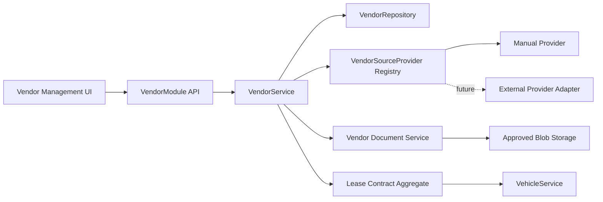

# Vendor-to-Vehicle Implementation Plan

| Field | Value |
|---|---|
| Workstream | `VENDOR-VEHICLE-01` |
| Status | `VERIFIED - VENDOR/VEHICLE/BOOKING HEALTH CHAIN` |
| Updated | 2026-07-23 |
| Business target | Create and govern Vendors in Wayfinder, create usable lease contracts, and consume those records safely during Vehicle Management onboarding. |
| Immediate next slice | Live Booking consent/confirmation and My Bookings/change lifecycle. |
| Future boundary | Organization provider configuration and external Procurement/Oracle adapters remain disabled until approved and verified. |

## 1. Outcome and Non-Negotiable Boundary

Wayfinder must support three organization adoption styles without changing Vehicle business logic:

1. `ManualOnly`: Vendor records are created, approved and maintained in Wayfinder.
2. `IntegratedOnly`: a configured external provider owns Vendor records; Wayfinder stores a read-only mirror.
3. `Mixed`: externally mastered Vendors coexist with controlled manual exceptions.

The current operational mode is `ManualOnly`. The source-provider interface and per-record `sourceMode` are implemented, but no external connection is live. The UI must continue to show Integrated records as read-only and must never display a successful synchronization state from fixtures or stubs.

Vehicle Management is the immediate consumer:

- `Leased` and `Lease replacement` onboarding require an Active Vendor and a usable lease contract owned by the same organization and Vendor.
- `Owned new` and `Transfer in` do not carry Vendor or lease identifiers.
- The backend revalidates every relationship; React selection is not authority.

Booking is an indirect consumer only. It must not read or expose Vendor commercial
data. Vendor and lease governance determines whether a Vehicle may enter and remain
in service; Booking consumes the resulting Vehicle scope, lifecycle, pool and
compliance state.

## 2. Current Verified Baseline

| Capability | Current state | Evidence anchor |
|---|---|---|
| Manual Vendor create/list/detail | Implemented | `app-api/src/modules/vendors/**`, `app-ui/src/features/vendors/**` |
| Lookup-backed Vendor category | Implemented | `vendor-category` migration seed and lookup UI |
| Vendor lifecycle | Implemented | Draft, Pending Approval, Active, Suspended, Retired |
| Maker-checker approval | Implemented | creator/submitter actor references; self-approval denied |
| Organization isolation | Implemented | organization-filtered repositories and composite foreign keys |
| Manual/Integrated provider seam | Implemented | provider registry + fail-closed resolver |
| Integrated record writes | Denied | service gate and read-only UI |
| Lease contract create/list | Implemented | Active-Vendor child action |
| Vehicle Vendor/lease selection | Implemented | governed IDs, server-side active/match/expiry checks |
| Transfer-in ownership | Implemented | maps to Owned and omits Vendor/lease keys |
| Vendor documents | Implemented | migrations `0036/0037`, versioned API, governance UI and verified lifecycle tests |
| Five-step Vendor onboarding | Partial | current manual create drawer only |
| Vendor activation completeness | Missing | approval enforces maker-checker but does not yet require confirmed mandatory documents |
| Organization source configuration | Missing/deferred | no organization provider settings table/API |
| External Procurement adapter | Future | Integrated provider intentionally throws typed unavailable response |
| OCR, AP feed, Vendor portal | Future | no live adapter may be claimed |
| Vendor scorecard/off-hire | Missing/later | depends on operational projections and contract workflows |

## 3. Current Vehicle and Booking Fit

Assessment date: 2026-07-23. Result: `FIT_WITH_RECORDED_GAPS`.


Verified fit:

- Leased Vehicle creation requires an Active Vendor and a same-organization lease
  belonging to that Vendor with a usable status and non-expired end date.
- Owned and transfer-in Vehicles reject Vendor and lease identifiers.
- New Vehicles default outside the booking pool. Pool activation requires current
  Mulkiya and insurance evidence.
- Booking availability is hierarchy scoped, requires the pool flag, excludes
  overlapping persisted reservations and excludes maintenance, off-hire and terminal
  lifecycle states.
- Consent signing re-evaluates driver and Vehicle eligibility before reservation.
  The hard gate requires lifecycle `Active`, a pool-enabled Vehicle, current Vehicle
  documents, an eligible driver and no active access block.
- Booking therefore depends on Vehicle operational truth. It does not depend directly
  on Vendor bank, contract-price or document-vault data.

Recorded gaps before end-to-end closure:

| Priority | Gap | Safe current behavior | Required closure |
|---|---|---|---|
| Closed | Availability, create/modify and consent previously used different lifecycle checks. | One common-domain predicate now requires lifecycle `Active` plus the pool flag; real-database availability and create/modify regressions pass. | Closed by BOOKING-VEH-FIT-1. |
| Closed | Vendor approval previously did not compute required document completeness. | Submission may remain incomplete, but every transition to `Active` now requires lookup-configured confirmed/current evidence. | Closed by the Vendor activation gate and unit/integration/HTTP evidence. |
| P1 | Suspension/retirement of a Vendor, or expiry/suspension of a lease, does not automatically quarantine already-linked Vehicles. | New leased Vehicle onboarding revalidates current Vendor and lease state. Existing Vehicles remain governed by their own lifecycle, pool and compliance checks. | Add a projection/event consumer or synchronous operational check that places affected Vehicles on hold/non-bookable with audit evidence. |
| P1 | `CLOSED`: Vendor -> lease -> Vehicle -> Booking now covers success, deterioration and restoration. | Booking receives only Vehicle-safe availability fields; Vendor/lease identifiers and commercial data are not exposed. | Migration `0043`, combined integration and audit evidence. |
| P2 | Booking UI module journeys remain incomplete. | Backend authority, overlap and eligibility gates remain authoritative. | Complete live availability, consent, My Bookings and operational status/error states without exposing Vendor commercial data. |

Fit decision:

- Vehicle Management may continue using the current Vendor and lease records for onboarding.
- Booking may continue using Vehicle state and eligibility as its only operational input.
- The P0 safety blockers are closed; production-flow closure still depends on linked-Vehicle deterioration behavior and the remaining live UI journeys.
- Vendor commercial/document details remain inside Vendor Management and approved
  governance roles; Booking receives only Vehicle eligibility outcomes and reason codes.

## 4. Target Module Boundary



Ownership rules:

- VendorModule owns Vendor identity, lifecycle, source label, document evidence and lease contracts.
- VehicleModule stores governed Vendor/lease references but does not edit Vendor commercial data.
- Organization Administration will later own organization-level provider configuration.
- Credentials remain in approved secret storage, never Vendor or organization JSON payloads.

## 5. Delivery Sequence

### VENDOR-1 - Document Vault Foundation

Status: `VERIFIED` on 2026-07-23.

Deliver:

- additive `vendor_document` table and migration;
- lookup-backed document types;
- immutable versions per Vendor/document type;
- manual metadata capture: reference, issue date, expiry date and blob reference;
- statuses `Uploaded`, `PendingConfirmation`, `Confirmed`, `Superseded`, `Rejected`;
- human confirmation/override evidence;
- organization-filtered repository operations;
- role gates for configure/read/confirm;
- audit and outbox in the same transaction;
- list, create, confirm and supersede APIs;
- focused unit, HTTP and integration tests.

Safe Phase-1 upload behavior:

- metadata and an approved blob reference may be submitted;
- the API does not pretend OCR ran;
- OCR proposal fields remain nullable and future-owned;
- no document is compliance-valid until a human confirms it.

Exit gate:

- cross-organization reads and writes fail;
- version race cannot create duplicate active versions;
- confirmation records actor and time;
- failed audit/outbox write rolls back the document mutation;
- fresh migration and idempotency pass.

Closure evidence:

- migrations `0036_vendor_document_vault` and `0037_vendor_document_lineage_guard`;
- immutable versions, pending/current uniqueness and same-parent lineage trigger;
- governance-only full evidence reads and Fleet Manager HTTP denial;
- strict client contract, opaque storage object keys and server-owned OCR proposal fields;
- manual create/confirm/reject/supersede lifecycle with audit/outbox transaction;
- concurrency, replacement retention/rejection recovery and injected outbox rollback tests;
- EN/AR document list/create/confirm, empty and retryable error states;
- independent review found no Blocking/High finding.

### VENDOR-2 - Five-Step Vendor Onboarding

Depends on: VENDOR-1.

Status: `VERIFIED` on 2026-07-23.

Delivered:

- migration `0038_vendor_onboarding_profile` for organization-scoped reusable Vendor terms and internal/manual access mode;
- tenant-scoped profile upsert/read with audit and outbox evidence;
- server-owned completeness derived from Vendor identity, persisted terms and lookup-configured current confirmed documents;
- persisted Draft recovery, localized unsaved-change protection and real document-vault reuse;
- five-step EN/AR wizard with lookup-backed category, disabled future integration dependencies and maker-checker submission;
- responsive browser verification at 320, 768, 1024 and 1440 with RTL and no horizontal overflow.

Deliver the approved screens as one persisted Draft journey:

1. Source and identity: Manual active; external lookup disabled as `Future integration`.
2. Compliance documents: real Vendor document API, manual confirmation, required/optional rules.
3. Terms and SLA: persist Vendor terms profile or clearly scoped Vendor defaults; do not overload lease contracts.
4. Integration and access: disabled dependency cards only; no fixture success.
5. Review and submit: server-authoritative completeness and maker-checker handoff.

Required states:

- loading, empty, validation, denied, conflict, unavailable dependency, success;
- unsaved-change protection and recoverable Draft;
- English and Arabic/RTL at 320, 768, 1024 and 1440;
- keyboard step navigation and focus restoration.

Exit gate:

- Vendor Draft survives refresh;
- required evidence is read from the server;
- submission can occur with incomplete optional evidence but activation remains blocked by missing required evidence;
- no Vendor is activated by client sequencing.

### VENDOR-3 - Procurement Approval Inbox

Depends on: VENDOR-2.

Status: `VERIFIED` on 2026-07-23.

Delivered:

- migration `0042_vendor_approval_worklist` adds an indexed submission timestamp;
- organization-scoped governance worklist with maker, submitter, assigned Procurement authority, completeness, document state and change summary;
- approve, reject and required-reason request-change operations using the existing transactional audit/outbox lifecycle;
- service-level blank-reason rejection, maker-checker SoD and immutable audit-chain verification;
- role-gated EN/AR Procurement inbox inside the existing Vendor module, with activation-aware approval gating and responsive master-detail composition.

Deliver:

- Pending Approval worklist;
- maker, submitter, evidence completeness and change summary;
- approve, reject and request-change operations;
- assigned authority and SoD enforcement at HTTP/service boundaries;
- immutable decision/audit evidence.

### VENDOR-4 - Organization Provider Configuration

Status: `DEFERRED_DECISION`.

Deliver only after source authority is approved:

- `ManualOnly`, `IntegratedOnly`, `Mixed` organization modes;
- provider code and versioned configuration;
- manual-create allowance and conflict strategy;
- connection status, freshness and last-known-good state;
- configuration API restricted to organization administration;
- no credentials in relational configuration rows;
- feature-level provider resolution using organization configuration plus record source mode.

Human decisions required before activation:

- authoritative system and supplier key;
- organization/business-unit mapping;
- sync direction and conflict precedence;
- stale threshold, retry behavior and outage fallback;
- reconciliation owner and evidence retention.

### VENDOR-5 - External Adapter

Status: `FUTURE`.

Implement the first real adapter only after VENDOR-4 decisions and environment approval. It must provide connection testing, paged/delta pulls, idempotent upsert, reconciliation, retry/backoff, telemetry and last-known-good behavior. External records remain read-only during outages; they never silently fall back to Manual.

### VENDOR-6 - Scorecard, Off-Hire and Reconciliation

Status: `LATER`.

Deliver computed scorecards, off-hire workflow, penalty evidence and invoice discrepancies only from real maintenance, downtime, contract and Finance inputs. Vendor users never self-report authoritative scores.

## 6. Data Model for VENDOR-1

Proposed additive entity:

| Field | Purpose |
|---|---|
| `id` | Stable document-version ID |
| `organization_id` | Tenant boundary |
| `vendor_id` | Parent Vendor, composite organization-safe FK |
| `document_type_code` | Lookup-backed classification |
| `version` | Monotonic version per Vendor/type |
| `document_reference` | Licence/policy/agreement reference |
| `blob_ref` | Approved storage reference, not raw file bytes |
| `issue_date`, `expiry_date` | Governed dates |
| `status` | Upload/confirmation/supersession lifecycle |
| `extracted_metadata` | Nullable future OCR proposal only |
| `confirmed_metadata` | Human-confirmed values |
| `confirmed_by_actor_ref`, `confirmed_at_utc` | Confirmation evidence |
| `superseded_by_id` | Version lineage |
| timestamps | Audit-friendly chronology |

Required constraints:

- composite Vendor organization FK;
- unique `(organization_id, vendor_id, document_type_code, version)`;
- at most one current Confirmed version per Vendor/type;
- expiry cannot precede issue date;
- confirmed status requires confirmer and timestamp;
- no update/delete of confirmed evidence except governed supersession.

## 7. API Plan

VENDOR-1 endpoints:

```text
GET  /api/v1/vendors/:vendorId/documents
POST /api/v1/vendors/:vendorId/documents
GET  /api/v1/vendors/:vendorId/documents/:documentId
POST /api/v1/vendors/:vendorId/documents/:documentId/confirm
POST /api/v1/vendors/:vendorId/documents/:documentId/reject
POST /api/v1/vendors/:vendorId/documents/:documentId/supersede
```

Stable reasons include:

- `vendor-document-not-found`
- `vendor-document-type-invalid`
- `vendor-document-version-conflict`
- `vendor-document-invalid-date-range`
- `vendor-document-confirmation-required`
- `vendor-document-cross-organization`
- `vendor-integrated-record-read-only`

## 8. Authorization and Sensitive Data

| Action | Roles |
|---|---|
| Vendor/document read | SystemAdmin, DataSteward, Procurement; operationally safe summary for approved Fleet roles later |
| Manual Vendor/document create/update | SystemAdmin, DataSteward, Procurement |
| Document confirmation | DataSteward, Procurement |
| Final Vendor approval | Procurement or approved separate authority; never creator/submitter |
| Full bank identity | Not stored in general Vendor tables in this phase |

Actor identity is server-bound. Organization, Vendor and document IDs from the request never grant authority.

## 9. Verification Matrix

| Layer | Required evidence |
|---|---|
| Migration | fresh apply, object/constraint checks, idempotent second apply |
| Contract | Zod positive/negative parsing and contract drift |
| Repository | tenant filtering, version ordering, current-version uniqueness |
| Service | state transitions, SoD, transaction rollback, audit/outbox |
| HTTP | 401/403, wrong role, cross-org, invalid payload, success |
| Frontend | EN/AR, RTL, keyboard, loading/error/empty/conflict/success |
| Integration | Vendor create -> evidence -> submit -> separate approval -> lease -> leased Vehicle |
| Review | independent Blocking/High critique and remediation |

## 10. Explicit Non-Claims

Until the corresponding exit gates pass, do not claim:

- Oracle/Fusion or Finance synchronization is connected;
- OCR extracted or approved document data;
- Vendor portal access is enabled;
- organization provider mode is configurable;
- the full five-step onboarding is complete;
- document expiry automatically suspends a Vendor;
- Vendor or lease deterioration automatically quarantines linked Vehicles;
- Booking availability and consent share one lifecycle predicate;
- scorecards, off-hire or invoice reconciliation are operational.

## 11. Pending Delivery Order

| Order | Slice | Owner | Dependency | Exit evidence |
|---|---|---|---|---|
| 1 | VENDOR-2 persisted five-step onboarding and completeness projection - `VERIFIED` | Vendor backend/frontend | Verified VENDOR-1 document aggregate and activation gate | Migration `0038`; Vendor unit 3/3 and integration 20/20; frontend 18 files/76 tests and focused Vendor 11/11; build and EN/AR responsive browser checks pass |
| 2 | VENDOR-3 approval/request-change inbox - `VERIFIED` | Vendor + Workflow | VENDOR-2 completeness contract | Migration `0042`; Vendor unit 5/5, integration 21/21 and guarded HTTP 1/1; frontend 18 files/79 tests; EN/AR responsive browser evidence |
| 3 | VEH-VENDOR-HEALTH-1 linked-Vehicle quarantine/restoration - `VERIFIED` | Vendor + Vehicle + Compliance | Approved deterioration policy | Migration `0043`; unit 9/9; Vendor+Booking 26/26; hourly expiry worker; override denial; audit/outbox/history evidence |
| 4 | BOOKING-2/3 live employee and operations journeys | Booking frontend/backend | Shared bookability predicate and approved mockups | Availability -> consent -> submit -> My Bookings E2E with role, RTL and failure states |
| 5 | VENDOR-4/5 provider configuration and first external adapter | Organization + Integration | Explicit source-authority decisions and approved environment | Versioned config, connection/reconciliation/security/runbook evidence |
| 6 | VENDOR-6 scorecard, off-hire and invoice reconciliation | Vendor + Operations + Finance integration | Real operational and Finance inputs | Computed evidence, workflow, reconciliation and audit tests |

## 12. Recovery Point

Current verified behavior is preserved. VENDOR-2, VENDOR-3 and VEH-VENDOR-HEALTH-1 provide persisted onboarding, Procurement decisions and safe linked-Vehicle deterioration/restoration without reopening external adapters. G-0020 and G-0021 are closed. Implementation returns to live Booking consent/confirmation and My Bookings. Existing broad worktree changes must not be reverted as part of this workstream.