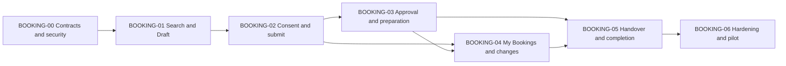

# Booking Core Implementation Plan

> **Status:** `ACTIVE_PLAN`
> **Updated:** 2026-07-29
> **Scope:** Pool Booking CORE-2 and CORE-3, plus the Booking/Handover completion boundary
> **Execution authority:** [Fleet Operations Core master status](../MASTER-STATUS.md)
> **Business narrative:** [Booking and Vehicle Management phases B1-B4](../../../../implementation-plan/booking_and_vehiclemanagement/README.md)

## 1. Purpose

Booking is the primary operational journey of the Fleet Platform. This pack converts the older B1-B4 business narrative into a code-aware delivery sequence based on the current NestJS, PostgreSQL/Drizzle and React implementation.

The older phase documents remain requirements and design references. They are not overwritten because their current-state statements are historical. This directory is the active implementation sequence and evidence gate.

## 2. Source Authority

Use sources in this order when they disagree:

1. Approved decisions in [DECISION-REGISTER.md](../DECISION-REGISTER.md), especially `D-SEQ-001`.
2. Approved mockup decisions in [mockup-review.md](../../../../implementation-plan/booking_and_vehiclemanagement/mockups/mockup-review.md) and [derived-screen-contracts.md](../../../../implementation-plan/booking_and_vehiclemanagement/mockups/derived-screen-contracts.md).
3. Booking business intent in phases [09](../../../../implementation-plan/booking_and_vehiclemanagement/09-live-pool-booking-foundation.md), [10](../../../../implementation-plan/booking_and_vehiclemanagement/10-booking-availability-eligibility-consent-and-submit.md), [11](../../../../implementation-plan/booking_and_vehiclemanagement/11-booking-approval-and-fleet-operations.md) and [12](../../../../implementation-plan/booking_and_vehiclemanagement/12-my-bookings-changes-and-completion.md).
4. Decision/workflow migration constraints in [8.2A](../../../decision-and-workflow-platform-plan/phase-8-domain-migration/02a-live-booking-user-journey.md) and [8.3](../../../decision-and-workflow-platform-plan/phase-8-domain-migration/03-booking-approval-workflow-migration.md).
5. Current source and executable tests as implementation evidence.

When role rules conflict, `D-SEQ-001` is newer and controls: `SystemAdmin` is administration/audit only and cannot create, approve, allocate or hand over operational bookings solely through that role.

## 3. Verified Current State

| Capability | Current implementation | Status | Completion phase |
|---|---|---|---|
| Booking schema, consent, events and decision provenance | PostgreSQL/Drizzle tables and migrations through `0044` | Implemented | BOOKING-00 verified |
| No-double-booking exclusion | PostgreSQL `btree_gist` exclusion on reserving statuses | Implemented | Phase 6 load evidence |
| Availability | Scoped `GET /v1/vehicles/available`; live seed returns `DEMO-01` through `DEMO-10` | Implemented | Phase 1 UI and HTTP evidence |
| Draft create authority | Principal, organization, requester, driver and Vehicle scope validation | Implemented | Phase 0 guarded HTTP expansion |
| Scoped people projection | `GET /v1/bookings/people` with Principal and scope containment | Implemented | BOOKING-00 verified |
| Booking context/bootstrap | `GET /v1/bookings/context` with fail-closed dependency modes | Implemented | BOOKING-00 verified |
| Consent and number issuance | Atomic consent, number and reservation transaction | Implemented | Phase 2 principal/version hardening |
| Submit | Durable command replay; workflow, Booking link, event, audit and command result share one transaction | Implemented baseline | BOOKING-00 verified; definition pinning remains BOOKING-03 |
| Approval actions | Pinned workflow, assigned/delegated queue and approve/decline/request-change UI | Implemented; production flow gated by consent | BOOKING-03 technically verified |
| Read/detail/events | Principal-aware owner/scoped ID and event endpoints | Implemented baseline | BOOKING-00 verified |
| Modify/re-consent | Governed tolerance decision and consent voiding exist | Implemented backend | Phase 4 UI/race evidence |
| Extend/cancel | Commands exist with requester/scope checks | Partial lifecycle rules/UI | Phase 4 |
| My Bookings | Owner-scoped API and integrated list/detail tab | Read-only implemented; actions/events missing | Phase 4 |
| Pick-up/return completion | Handover open/return/damage backend and atomic Booking transitions | Backend implemented; frontend local-only | Phase 5 |
| Employee Booking UI | `/booking` uses live context, privacy-safe timeline, scoped availability and idempotent self Draft review | Implemented baseline | BOOKING-01 verified; consent/confirmation remains BOOKING-02 |
| Approval/My Bookings UI | Approval/preparation live; My Bookings read-only live | Change actions remain | Phase 4 |

## 4. Mandatory Mockup Traceability

Implementation must follow the approved files under [booking_and_vehiclemanagement/mockups](../../../../implementation-plan/booking_and_vehiclemanagement/mockups/README.md). The images control information architecture, density, grouping, visual hierarchy, status placement and primary interactions. The existing application shell, authenticated navigation, Wayfinder tokens and shared components control implementation styling.

| Source | Domain/phase | Mandatory composition | Active delivery |
|---|---|---|---|
| [21-booking-employee-book-a-vehicle.png](../../../../implementation-plan/booking_and_vehiclemanagement/mockups/21-booking-employee-book-a-vehicle.png) | Pool Booking B1-B2 | Employee heading; destination/window/passengers search; pool availability timeline with text legend; eligible Vehicle cards with plate/seats/fuel/location/availability and Book action | BOOKING-01 |
| Approved derived consent/confirmation contract | Pool Booking B2 | Inline consent Sheet/Dialog after Draft; persisted booking number/status, next step, handover guidance and My Bookings link | BOOKING-02 |
| [23-booking-create-on-behalf.png](../../../../implementation-plan/booking_and_vehiclemanagement/mockups/23-booking-create-on-behalf.png) | Pool Booking B1-B2 Fleet flow | Mode choice; driver eligibility block; trip facts; selectable eligible Vehicles; submit consequences; gated submission | BOOKING-00/01/02 after on-behalf gates |
| [25-booking-approvals-inbox.png](../../../../implementation-plan/booking_and_vehiclemanagement/mockups/25-booking-approvals-inbox.png) | Pool Booking B3 | Pending queue and selected request detail; identity/Booking ref; fact strip; system verdicts; justification; approve/request-change/decline action bar and SoD message | BOOKING-03 |
| Approved business-derived My Bookings contract | Pool Booking B4 | Upcoming/Active/Past; state-aware detail and events; modify/re-consent, extend, cancel and early-return actions | BOOKING-04 |
| [26-handover-custody-register-list.png](../../../../implementation-plan/booking_and_vehiclemanagement/mockups/26-handover-custody-register-list.png), [27](../../../../implementation-plan/booking_and_vehiclemanagement/mockups/27-handover-return-walkaround-inspection-with-scroll.png), [28](../../../../implementation-plan/booking_and_vehiclemanagement/mockups/28-handover-return-walkaround-inspection-without-scroll.png) | Handover H1 | Custody register; walkaround; odometer/fuel; damage/photos; key/signature; derived Return comparison and receipt | BOOKING-05/Handover |
| [24-booking-create-emergency-breakglass.png](../../../../implementation-plan/booking_and_vehiclemanagement/mockups/24-booking-create-emergency-breakglass.png) | Advanced Booking B5 | Emergency category, warning, confirmation and post-hoc review | Deferred until B5 decisions; not part of BOOKING-00 through 06 |
| [22-booking-employee-dedicated-vehicle-request.png](../../../../implementation-plan/booking_and_vehiclemanagement/mockups/22-booking-employee-dedicated-vehicle-request.png) | Dedicated Entitlement D1-D2 | Dedicated request and eligibility | Separate Entitlement domain; not Pool Booking |

### Fidelity Rules

1. Do not redesign, replace or duplicate the existing shell and do not build the mockup role switcher or prototype editor chrome.
2. Preserve each source screen's content regions, reading order, density and action hierarchy using existing shared components.
3. Replace every sample person, Vehicle, time, availability bar, cost, verdict and count with authorized API data.
4. If a visible mockup fact lacks a verified backend source, implement that backend projection first. Until then, render an explicit unavailable/loading/empty state in the same region; never remove the region silently or fabricate data.
5. Screen `21`'s timeline is therefore required. It must use a privacy-safe scoped occupancy projection that exposes availability labels/ranges without another user's identity or purpose.
6. Pool-peak forecasting, estimated fuel/cost and recommendation labels appear only when their verified services/contracts exist; otherwise the region states `Not available` and no recommendation is claimed.
7. All visible copy uses EN/AR catalogs; identifiers use `<bdi>`; responsive evidence is required at 320, 768, 1024 and 1440.
8. Status is icon/text plus color, and every control remains keyboard and screen-reader operable.

## 5. Non-Negotiable Rules

1. Authenticated actor, organization and role scope are server-bound.
2. Employee self-service is owner-only. Operational on-behalf actions require an approved role, organization equality, hierarchy containment and distinct actor/requester/beneficiary/driver evidence.
3. `SystemAdmin` alone grants no operational Booking authority.
4. The actual driver signs consent. Fleet actors cannot impersonate driver consent.
5. No booking number or reserving status exists before consent commits.
6. Availability and commit use the same reservation range and shared Vehicle bookability predicate.
7. Eligibility and compliance fail closed; no UI or admin override bypasses hard blocks.
8. Commands exposed to retry require durable idempotency.
9. Every state change records domain event, audit evidence and outbox effects in the owning transaction.
10. UI status and available actions come from persisted server state/capabilities, never inferred from client step order.
11. EN/AR, RTL, keyboard, screen-reader and 320/768/1024/1440 evidence are phase exit requirements.
12. Production routes contain no mock arrays, synthetic success, fake availability or unverified integrations.

## 6. Phase Map

| Phase | File | Outcome | Depends on |
|---|---|---|---|
| BOOKING-00 | [00-contract-security-and-data-baseline.md](00-contract-security-and-data-baseline.md) | Verified actor, beneficiary, scope, state and durable command baseline | `VERIFIED` 2026-07-24 |
| BOOKING-01 | [01-live-search-and-draft.md](01-live-search-and-draft.md) | Verified live Employee search, privacy-safe timeline, Vehicle selection and idempotent Draft | `VERIFIED` 2026-07-24 |
| BOOKING-02 | [02-consent-submit-and-confirmation.md](02-consent-submit-and-confirmation.md) | Governed consent, number, reservation, submit and confirmation verified; target environments activate accepted wording | `VERIFIED_GOVERNED_CONSENT_LOCAL` 2026-07-29 |
| BOOKING-03 | [03-approval-and-fleet-preparation.md](03-approval-and-fleet-preparation.md) | Pinned immutable workflow/route lineage, atomic idempotent decisions, scoped approval inbox and preparation queue verified | `VERIFIED` 2026-07-29 |
| BOOKING-04 | [04-my-bookings-and-change-lifecycle.md](04-my-bookings-and-change-lifecycle.md) | Live My Bookings, immutable history, modify/re-consent, extend and cancel | `VERIFIED` 2026-07-29 |
| BOOKING-05 | [05-handover-and-completion-boundary.md](05-handover-and-completion-boundary.md) | Atomic live custody register, open/return/damage and receipt | `VERIFIED` 2026-07-29 |
| BOOKING-06 | [06-hardening-pilot-and-rollout.md](06-hardening-pilot-and-rollout.md) | Automated hardening verified; named human production gates remain | `TECHNICALLY_VERIFIED_HUMAN_PRODUCTION_GATES_PENDING` 2026-07-29 |

## 7. Backend/Frontend Contract Matrix

| ID | Frontend workflow | Backend capability/API | Permission | Stable failures | Audit/outbox | Phase/status |
|---|---|---|---|---|---|---|
| BC-01 | Initialize Booking page | `GET /v1/bookings/context` | Linked Employee/Fleet operational role | unlinked, no home scope, dependency unavailable | Read audit only if sensitive fields included | BOOKING-00 Draft |
| BC-02 | Select requester/driver | `GET /v1/bookings/people` using existing scoped projection | Employee self; scoped Fleet roles for others | foreign org, outside scope | Sensitive-read audit as required | BOOKING-00 Draft |
| BC-03 | Search available Vehicles | `GET /v1/vehicles/available` | Linked person in authorized closure | invalid window, unlinked, no authorized scope | Query telemetry | Implemented; BOOKING-01 UI |
| BC-04 | Create Draft | `POST /v1/bookings` plus idempotency key | Employee self first; on-behalf after G-0006 closure | inactive person, scope/org mismatch, Vehicle not bookable, invalid duration | `BOOKING_DRAFTED`; no outbox unless notification is required | Partial; BOOKING-00/01 |
| BC-05 | Read Booking and events | `GET /v1/bookings/:id`, `/events` | Owner or scoped operational role | opaque not-found/forbidden | Sensitive read audit where required | Partial; BOOKING-00 |
| BC-06 | Load governed consent | Server-authoritative registry template/version/hash in context or Draft projection | Persisted driver/requester | template unavailable/version changed | Template activation/access/version evidence | Implemented; BOOKING-02 |
| BC-07 | Sign consent and reserve | `POST /v1/bookings/:id/consent` plus idempotency key | Authenticated persisted driver only | eligibility deny, version changed, overlap conflict, stale state | `BOOKING_RESERVED`, `ConsentSigned` | Partial; BOOKING-02 |
| BC-08 | Submit for approval | `POST /v1/bookings/:id/submit` plus idempotency key | Owner/scoped actor allowed by current state | consent missing, no approver, duplicate/race | `BOOKING_SUBMITTED`; workflow/outbox once | Partial; BOOKING-02/03 |
| BC-09 | Approval inbox and decision | `GET /v1/booking-approvals`; approve/decline/request-changes | Assigned approver/delegate in scope; no requester/SystemAdmin self authority | stale task, SoD, scope, already decided | immutable decision, audit, notifications | Missing queue; BOOKING-03 |
| BC-10 | Fleet preparation queue | `GET /v1/booking-preparation` | Scoped Fleet roles | outside scope, stale compliance/custody | read audit/operational telemetry | Missing; BOOKING-03 |
| BC-11 | My Bookings | `GET /v1/bookings` with cursor/filter projection | Employee own only | invalid cursor/filter | query telemetry | Missing; BOOKING-04 |
| BC-12 | Modify/re-consent | `PATCH /v1/bookings/:id` plus revision/idempotency | Owner/scoped Fleet actor | stale revision, decision race, unavailable Vehicle | `BOOKING_MODIFIED`, void evidence | Backend partial; BOOKING-04 |
| BC-13 | Extend/cancel | `/extend`, `/cancel` plus revision/idempotency | Server capability and owner/scope | conflict, cutoff, active handover, stale state | `BOOKING_CHANGED`/`BOOKING_CANCELLED` | Backend partial; BOOKING-04 |
| BC-14 | Pick-up and return | Handover commands invoke Booking transition atomically | Scoped Handover actor; persisted driver/Booking | not approved/active, stale evidence, concurrent return | custody + Booking audit/outbox once | Partial; BOOKING-05 |

All Draft rows require backend owner `ai-backend-nestjs`, frontend owner `ai-frontend-react`, and executable contract/HTTP evidence before UI integration.

## 8. Entity Completion Matrix

| Entity | Storage/API today | Missing completion work | Phase |
|---|---|---|---|
| Booking | Table, repository, service and ID API | Beneficiary/direct scope evidence, revision/capabilities, list projection | BOOKING-00/04 |
| Consent record/lifecycle event | Immutable tables and sign command | Server-authoritative template/version contract and authenticated-driver HTTP proof | BOOKING-02 |
| Booking event | Append-only table and ID event API | Principal-aware read/masking and event catalog freeze | BOOKING-00 |
| Booking policy decision | Append-only provenance table | Authorized summary projection for UI without raw private facts | BOOKING-00/03 |
| Workflow instance/step | Runtime tables and service | Immutable definition/version pinning, delegation validation and race control | BOOKING-03 |
| Booking command ledger | Implemented in migration `0044` and requester command services | Retention policy remains operational hardening | BOOKING-06 |
| Booking list/read model | Missing | Cursor paging, owner/scope predicates, capability projection and indexes | BOOKING-04 |
| Preparation/approval queue | Missing | Scoped projections, SLA fields, assignee/delegate evidence and indexes | BOOKING-03 |

## 9. Deferred Scope

Waitlist, recurring series, emergency/break-glass, cross-node booking, professional/substitute-driver automation and advanced no-show behavior remain B5. They cannot expand BOOKING-01 through BOOKING-06 without an approved scope decision. Emergency may bypass approval only; it never bypasses consent, eligibility or compliance.

## 10. Open Decisions and Gates

| Decision | Owner | Due before | Safe behavior until decided | Impact |
|---|---|---|---|---|
| Confirm provisional Fleet on-behalf scope and beneficiary semantics (`D-SCOPE-PROVISIONAL`) | Product owner + Solution Architect | On-behalf enablement in BOOKING-00/01 | Employee self-booking only; hide/deny on-behalf | On-behalf cannot be claimed complete |
| Approve consent template owner, EN/AR legal text, version/effective-time model and retention | Legal/Privacy + Product owner | BOOKING-02 implementation | Draft may exist; consent/reservation live capability remains disabled | No lawful live confirmation without approval |
| Choose consent content storage: governed DB registry or approved document/config service | Solution Architect + Legal/Privacy | BOOKING-00 contract freeze | Define interface only; do not hard-code frontend text/version | Determines migration, caching and outage behavior |
| Approve workflow start boundary: shared DB transaction executor or transactional outbox command | Solution Architect + Workflow owner | Resolved in BOOKING-00 | Shared Drizzle transaction executor implemented and failure-injection tested | Closed for Booking submit; immutable workflow definition pinning remains BOOKING-03 |
| Confirm cancellation cutoffs, extension approval/mediation and SLA values | Product owner + Fleet Operations | BOOKING-04 command enablement | Return server capability as unavailable; preserve read-only history | Actions cannot be enabled safely without governed values |
| Name pilot pool, UAT actors, support and rollback owners | Fleet Operations + Release owner | BOOKING-06 entry | No production capability enablement | Blocks pilot, not development |

These are phase gates, not placeholders. If an owner does not approve by the due phase, the safe behavior in the table remains mandatory.

## 11. Definition of Done

A phase is complete only when its DB, API, authorization, audit/outbox, frontend, EN/AR/RTL, accessibility, automated tests, browser evidence, observability and rollback rows pass. A service-only or mock-only success remains `Partial`.
