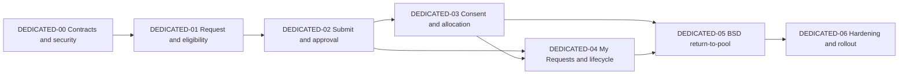

# Dedicated Vehicle Implementation Plan

> **Status:** `TECHNICALLY_COMPLETE_LOCAL_MANUAL_FLOW`
> **Updated:** 2026-07-25
> **Scope:** CORE-5 Dedicated Entitlement D1-D2
> **Execution authority:** [Fleet Operations Core master status](../MASTER-STATUS.md)
> **Active journey contract:** [8.5A Live Dedicated Vehicle Journey](../../../decision-and-workflow-platform-plan/phase-8-domain-migration/05a-live-dedicated-vehicle-journey.md)

## 1. Purpose

This pack converts the broad Dedicated Vehicle journey into a code-aware implementation sequence for the current NestJS, PostgreSQL/Drizzle and React platform. Dedicated Vehicle is an effective-dated entitlement and allocation lifecycle, not a Pool Booking variation.

The requester may choose a permitted class, optionally select one currently eligible Vehicle as a non-binding preference, and optionally enter a preference note. Fleet retains final allocation authority after approval and consent.

## 2. Source Authority

Use sources in this order when they disagree:

1. Approved decisions in [DECISION-REGISTER.md](../DECISION-REGISTER.md).
2. Approved mockup disposition in [mockup-review.md](../../../../implementation-plan/booking_and_vehiclemanagement/mockups/mockup-review.md).
3. PRD C3 / FR-DVR-01 through FR-DVR-13 in [Fleet Management Platform PRD](../../../../startup-doccs/02_Fleet_Management_Platform_PRD_v3.0.md).
4. Active journey contract [8.5A](../../../decision-and-workflow-platform-plan/phase-8-domain-migration/05a-live-dedicated-vehicle-journey.md).
5. D1/D2 business phases [14](../../../../implementation-plan/booking_and_vehiclemanagement/14-dedicated-vehicle-request-and-eligibility.md) and [15](../../../../implementation-plan/booking_and_vehiclemanagement/15-dedicated-approval-consent-allocation-and-bsd.md).
6. Current source and executable tests as implementation evidence.

## 3. Current-State Summary

| Capability | Current state | Completion phase |
|---|---|---|
| Create/list/get/submit | Legacy API exists; not principal/owner/scope complete | DEDICATED-00/01/02 |
| Duration and driver axes | `requestType` plus nullable `driverOption` exist | DEDICATED-00 |
| Eligibility | Manual direct-fact deny-by-default D8 policy, preview and pinned evidence verified | DEDICATED-01 |
| Approval | Legacy workflow start/decision; no pinned immutable route/evidence parity | DEDICATED-02 |
| Consent | Legacy command exists; assigned-driver/version/source hardening missing | DEDICATED-03 |
| Allocation | `vehicleId` update exists without full qualification/exclusivity (`G-0010`) | DEDICATED-03 |
| My Requests/lifecycle | No production React journey; lifecycle incomplete | DEDICATED-04 |
| BSD return-to-pool | Legacy create window only; no governed state machine/auto-reversion | DEDICATED-05 |
| Frontend route | Live EN/AR Draft, eligibility and optional preference journey | DEDICATED-01 |

## 4. Non-Negotiable Business Rules

1. Employee self-request and authorized Fleet on-behalf request remain distinct.
2. Actor, requester/beneficiary, assigned driver, approver and allocator are separate identities.
3. SystemAdmin alone cannot submit, approve, consent or allocate.
4. Eligibility returns permitted classes and reasons; it does not allocate a Vehicle.
5. `preferredVehicleId` and `preferenceNote` are optional, non-binding request evidence.
6. The preference dropdown contains only currently eligible, Employee-safe Vehicle options and creates no hold.
7. Fleet makes final allocation after approval and assigned-driver consent.
8. A different allocation requires an auditable governed variance reason; it cannot widen the approved class or policy entitlement, and the original preference remains immutable evidence.
9. Dedicated allocation is exclusive for its effective range. Dedicated Vehicles are outside the pool except during confirmed BSD windows.
10. Every retryable command uses durable idempotency; every mutation writes audit/outbox evidence in the owning transaction.
11. Production routes contain no fixtures, guessed policy thresholds or fabricated cost/availability claims.
12. EN/AR, RTL, keyboard, screen-reader and responsive evidence are phase exit requirements.

## 5. Phase Map

| Phase | File | Outcome | Entry status |
|---|---|---|---|
| DEDICATED-00 | [00-contract-security-data-baseline.md](00-contract-security-data-baseline.md) | Principal, scope, lifecycle, preference, provenance and exclusivity design baseline | Ready for contract work; business gates recorded |
| DEDICATED-01 | [01-request-eligibility-and-draft.md](01-request-eligibility-and-draft.md) | Live employee request, eligibility, optional preference and Draft | Verified with manual Reference Data and Policy Studio configuration |
| DEDICATED-02 | [02-submit-and-approval-workflow.md](02-submit-and-approval-workflow.md) | Idempotent submission and immutable approval workflow | Depends on 00/01 |
| DEDICATED-03 | [03-consent-and-fleet-allocation.md](03-consent-and-fleet-allocation.md) | Assigned-driver consent and exclusive Fleet allocation | Depends on Legal source and G-0010 closure |
| DEDICATED-04 | [04-my-requests-and-lifecycle.md](04-my-requests-and-lifecycle.md) | My Requests, modification, renewal, cancellation, return and expiry | Depends on 02/03 contracts |
| DEDICATED-05 | [05-bsd-return-to-pool.md](05-bsd-return-to-pool.md) | Governed BSD scheduling, pool activation and automatic restoration | Depends on allocation and HR/BSD policy |
| DEDICATED-06 | [06-hardening-pilot-and-rollout.md](06-hardening-pilot-and-rollout.md) | Security, concurrency, accessibility, UAT and rollout evidence | Depends on 00-05 |
| DEDICATED-07 | [07-residual-hardening-and-core6-handoff.md](07-residual-hardening-and-core6-handoff.md) | Residual engineering, UAT package, full regression repair and CORE-6 handoff | DEDICATED-06 technical verification |

## 6. Preference Contract

| Input | Source | Required | Meaning |
|---|---|---|---|
| Approved class | Eligibility result | Yes before submission | Policy-permitted category/class |
| `preferredVehicleId` | Bounded eligible-options projection | No | Non-binding preference, not a hold/allocation; contract naming must remain distinct from final `vehicleId` |
| Preference note | Requester free text, max 500 | No | Operational context such as `Toyota Fortuner if available` or `Left-hand drive preferred - driving on E11` |
| Allocated Vehicle | Fleet allocation command | Only after approval/consent | Final exclusive assignment |
| Variance reason | Fleet controlled lookup/reason | Required when allocated Vehicle differs | Auditable explanation preserving original preference |

## 7. Mandatory Three-Round Critique Protocol

Every phase executes all three rounds. A phase cannot become `VERIFIED` with unresolved Blocking or High findings.

1. **Round 1 - Contract, security and data:** independent review of tenancy/scope, actor separation, privacy, state model, migrations, API schemas, idempotency, audit/outbox and rollback. Repair findings and rerun focused backend evidence.
2. **Round 2 - Behavior, policy and concurrency:** independent scenario/race review of eligibility, workflow, consent, allocation, retries, stale facts, concurrent commands and failure injection. Repair findings and rerun PostgreSQL/HTTP/E2E evidence.
3. **Round 3 - UX, accessibility and operations:** independent EN/AR/RTL, responsive, keyboard, screen-reader, empty/error/degraded-state and operational-support review against approved mockups. Repair findings and rerun UI tests, browser evidence and production build.

Each phase file contains round-specific lenses and required evidence. Every round produces a durable gap-analysis record containing scope, reviewer, findings by severity, owner, repair, rerun evidence, residual risks and closure decision. A checklist without findings/evidence is not a completed round.

## 8. Open Gates

| Gate | Owner | Safe behavior until approved |
|---|---|---|
| D3 justification categories | Application configuration | Manual bilingual Reference Data values verified; administrators may maintain them without an external integration |
| D8 eligibility rules | Application configuration | Manual Policy Studio rules verified; active baseline is deny by default and editable without deployment |
| D16 professional-driver scope | Product/HR/Legal | With-driver disabled with localized governance reason |
| Consent text/source | Legal/Privacy | Approval may progress only to AwaitingConsent; no allocation |
| G-0010 exclusivity/qualification | Architecture/DB/Fleet | Allocation command disabled |
| Extension/renewal semantics | Product/Fleet | Read-only expiry guidance; no silent extension |
| D14 utilization calculation | Finance/Fleet | No utilization enforcement or fabricated threshold |

## 9. Definition of Done

A phase is complete only when database, API, authorization, audit/outbox, frontend, EN/AR/RTL, accessibility, automated tests, browser evidence, observability and rollback rows pass, followed by all three critique rounds and closure re-review. Service-only, fixture-only or mock-only success remains Partial.
