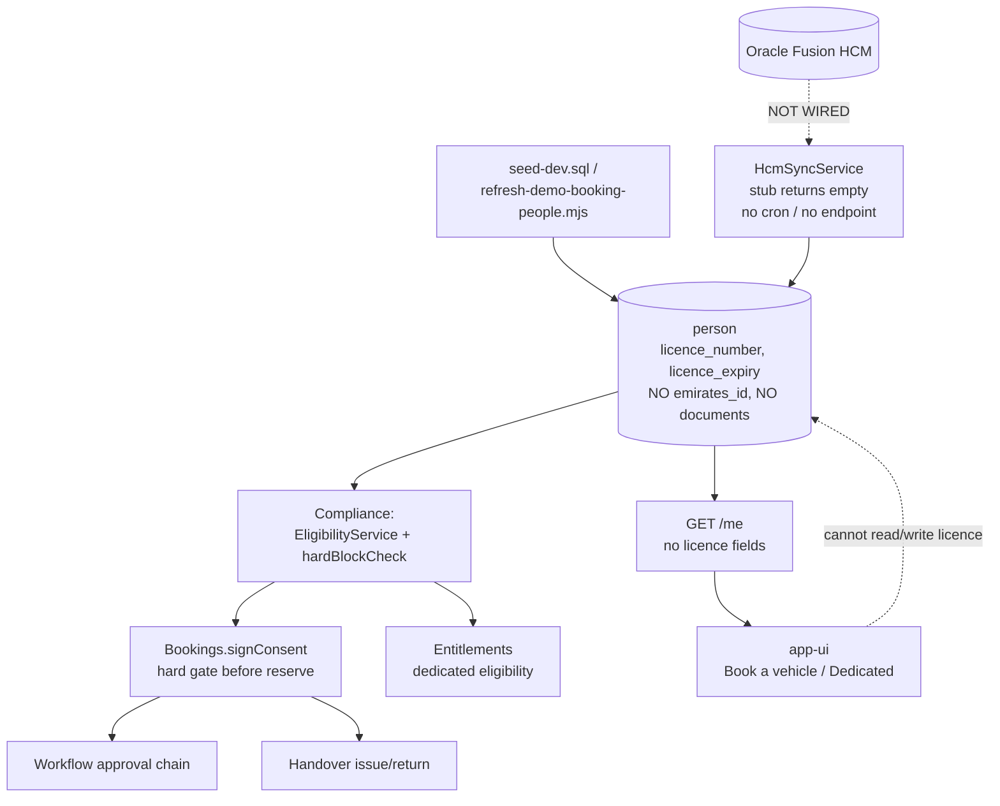
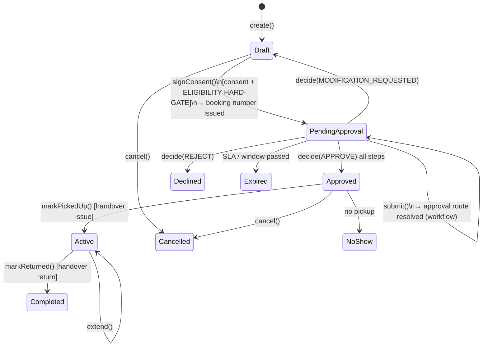
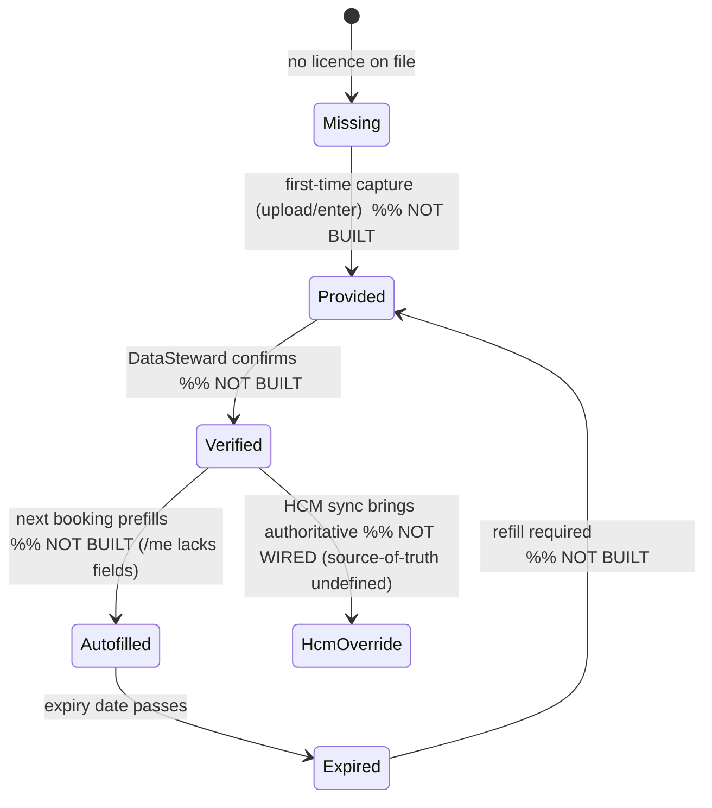

# Rigorous Critique — Module Connectivity, Booking Lifecycle & Employee/Driver Details (HCM vs Manual)

**Date:** 2026-07-31
**Author:** Engineering review (code-evidence based)
**Status:** Findings for triage — no code changed by this report
**Companion doc:** `docs/06-verification/gap-analysis-driver-licence-passenger-messaging.md` (licence/EID/passenger/messaging gaps). This report is the **systemic** view: how the modules connect, the two end-to-end lifecycles, and the **HCM-vs-manual source-of-truth** problem with full scenario coverage.

---

## 1. What was asked

- HCM integration exists in the codebase but may not actually be connected. It **should** fetch employee/driver data, **but the product must never fully depend on it** — manual entry must always be possible.
- If a user is **missing** required details, they should be able to **upload/enter** them at **first-time booking**; **next time it auto-fills**; if **expired**, they must **refill**.
- Deliverable: rigorous critique of **BE + FE + DB**, first connecting all modules/pages/logic, then the issues/gaps and the **complete lifecycle** of **booking** and **employee/driver details**.

**Bottom line:** The eligibility system is well-built and fail-safe, but it consumes employee/driver data that **has no live source and no manual-entry surface**. HCM sync is **coded but never runs** (no scheduler, no endpoint, stub source returns empty), and there is **no manual capture, no verification model, no expiry-refill flow, and `/me` doesn't even expose licence status** for auto-fill. The "HCM-optional, manual-always-possible" requirement is essentially **unimplemented end-to-end**.

---

## 2. System map — how the modules connect

### 2.1 Backend modules (`app-api/src/app.module.ts`)

Cross-cutting: `CoreConfig`, `ScheduleModule`, `Logging`, `Database`, `Redis`, `Escalation`, `Messaging`, `Notifications`, `Auth`.
Domain: `Platform` (HCM sync, SoD, scope-authorization, audit, access, delegation, hierarchy), `OrganizationAdministration`, `Geocoding`, `Config` (reference lookups), `Identity` (dev-auth + user-admin), `PolicyAdministration`, `Workflow`, `Vehicles`, `Vendors`, `Migration`, `TelematicsDomain`, `Compliance` (eligibility gate), `Bookings`, `Handover`, `Entitlements` (dedicated), `Fines`, `Dashboards`, `Health`.

### 2.2 Frontend pages/routes (`app-ui/src/app/routing/router.tsx`)

`home`, `booking` (Book a vehicle), `dedicated-vehicle`, `approvals`, `booking-preparation`, `dedicated-allocation`, `handover` (+ `handover/new`, `handover/return`, `handover/work`, `handover/:id`), `vehicles` (+ `onboard`, `import`), `admin/*` (`access`, `organization`, `policy`, `consents`, `vendors-leases`, `reference-data`), `live-map`, `compliance`, `fines`.

### 2.3 Key DB tables (by domain)

- **Identity/org:** `person`, `role_assignment`, `hierarchy_node`, `organization`, `user_account`.
- **Vehicle:** `vehicle`, `vehicle_document`, `vehicle_hierarchy_assignment`, `vehicle_lifecycle_history`, `vehicle_transfer`.
- **Vendor:** `vendor`, `vendor_document`, `lease_contract`.
- **Booking:** `booking` (+ events), `consent_record`.
- **Dedicated:** `entitlement_request`, `eligibility_preview`.
- **Handover:** handover record + evidence + chain.
- **Telematics:** `device`, `device_pairing`, `telemetry`, `trip`, `alert`.
- **Policy:** `policy_rule`, `policy_version`, `policy_draft`; **Reference:** `lookup_type`, `lookup_value`.
- **Infra:** `outbox_event`, audit, `workflow_instance`/`workflow_step`, `fine`.

### 2.4 Connectivity (who depends on employee/driver data)

The red edges are the failure points: **HCM→Person is not wired**, and **FE↔Person licence is absent** in both directions (no read for autofill, no write for manual entry).

---

## 3. Booking lifecycle (complete)

### 3.1 State machine

Evidence: `app-api/src/modules/bookings/services/booking.service.ts` — `create` (L132), `signConsent` (L309, sets `status:'PendingApproval'` + `bookingNumber` at L455–457), `submit` (L491, route by `durationHours`), `decide` (L615), `markPickedUp` (L982), `markReturned` (L1003), `modify/extend/cancel`. Approval routing: `booking-approval-chain` (`policy-registry.ts` L69–78): ≤4h → `[LineManager]`; ≥24h → `[LineManager, FleetManager]`; else `[LineManager]`.

### 3.2 Where employee/driver data is consumed (the coupling)

1. **`signConsent` → `EligibilityService.evaluate({driverPersonId, vehicleId})`** *before reserving* (`booking.service.ts` L368). This is the hard gate.
2. **`EligibilityService.evaluate`** (`compliance/services/eligibility.service.ts` L23–58): loads `person`, checks **HCM freshness (24h)** → `hardBlockCheck` (`compliance/internal/eligibility-rules.ts` L36–48) on `licenceExpiry`, `employmentStatus`, vehicle `mulkiya/insurance`, active block, bookability → then PDP `driver-eligibility-gate`.
3. **`submit`** resolves the requester's `lineManagerPersonId` and role approvers.
4. **Dedicated** (`entitlements`) uses the same person facts (grade, employmentStatus) + its own eligibility policy.

> The booking's success at consent time is **entirely gated on `person` data** whose only real writer (HCM) is not running (§4). This is the structural root cause of the repeated "compliance check failed / hcm-data-stale" blocks.

---

## 4. Employee/Driver details lifecycle — current reality

### 4.1 The intended path (HCM) is not connected

- `HcmSyncService.reconcile()` exists (`platform/services/hcm-sync.service.ts` L18–45) and upserts `licenceNumber`/`licenceExpiry` via `upsertPersonFromHcm` (`platform/repositories/platform.repository.ts` L110–124).
- **But:** the source is `StubHcmSource.fetchActivePersons()` → **returns `[]`** (L57–63). There is **no `@Cron`** on the sync and **no controller endpoint** that invokes it (grep across the module found cron workers for entitlements/handover/vendor/workflow **but none for HCM**, and no `@Post('.../sync')`). So in every environment today, HCM sync **never executes** and would import nothing even if it did.
- Real data therefore comes only from `scripts/seed-dev.sql` and `scripts/refresh-demo-booking-people.mjs` (which stamps `updated_at_utc` and a licence expiry). Because the eligibility gate uses `person.updated_at_utc` as "last sync" with a **24h SLA** (`platform/internal/hcm.ts` L30), seeded people go **stale after a day** → `hcm-data-stale` block.

### 4.2 There is no manual-entry / self-service path

- `person` has `licence_number`/`licence_expiry` columns but **no `emirates_id`**, and there is **no `person_document` table** (`platform.schema.ts` L137–160). Person documents exist only for vehicles/vendors.
- The identity/user-admin module only does `assignRole` / `suspend` / `reactivate` (`identity/controllers/user-admin.controller.ts` L60–104) — **no create/edit person, no licence/EID write, no upload**.
- There is **no file-upload pipeline** anywhere — documents are metadata + a text `blobRef` object-key (no multipart / presigned / storage service).
- **`GET /me`** returns identity + roles but **omits `licenceNumber`, `licenceExpiry`, `emiratesId`, `isProfessionalDriver`** (`contracts/platform.contract.ts` L20–29). So the FE cannot **auto-fill**, cannot **warn** "your licence expires in N days," and cannot detect "missing → prompt."

### 4.3 The requested lifecycle vs. what exists

Every transition above is **unimplemented**. Additionally, a **missing** (null) licence currently **passes** the hard gate (only *expired* blocks — `eligibility-rules.ts` L41 with `isExpired(null)===false`), so today an employee with **no licence** can book — the opposite of the requirement.

---

## 5. Rigorous critique — issues & gaps

### 5.1 Source-of-truth is undefined (the core architectural gap)
There is no model for "HCM-authoritative-when-present, manual-fallback-otherwise." Because HCM isn't wired, `person` is effectively manual-only — yet there's no manual UI, and no **provenance** (`source`), **verification status**, or **conflict-resolution** rule for when HCM later returns data that differs from a self-entered value. Without provenance, a future HCM sync could silently overwrite verified manual data (or vice-versa).

### 5.2 HCM sync is dead code in practice
Coded but not scheduled, not exposed, and backed by an empty stub. This is a latent trap: it *looks* integrated (freshness SLA, upsert reconciler) so the gate trusts `updated_at_utc`, but nothing keeps it fresh → guaranteed staleness blocks in any environment older than a day. There is also no **observability** (no "last successful sync" surfaced, no health signal, no alert when sync is stale).

### 5.3 No manual capture surface (BE + FE + DB)
No columns for EID, no `person_document`, no upload pipeline, no write API, no UI. The requirement ("upload details for first-time booking") cannot be met without net-new data model + storage + endpoints + UI.

### 5.4 No auto-fill / expiry-warning data contract
`/me` omits credential fields, so even after data exists there's no way to prefill or to proactively warn before expiry. The user only discovers a problem at the **consent hard-gate**, framed as a generic compliance failure.

### 5.5 Missing-licence is not blocked (fail-open hole)
Only expired licences block; absent ones don't. This contradicts the requirement and is a compliance risk.

### 5.6 Diagnostics are masked
The specific block reason (`hcm-data-stale`, `licence-expired`, `licence-missing`, insurance/registration/block/inactive) is produced by the API but **swallowed** by the FE behind a generic message, and several codes have **no translations** (detailed in the companion doc §4).

### 5.7 Freshness SLA is a fixed 24h with no config or auto-refresh
Breaks demos/UAT and, in production without a live HCM feed, would block **everyone** after a day. No env override, no scheduled refresh.

### 5.8 No lifecycle for credential changes
No audit of who entered/changed a licence, no expiry notifications (the notifications/escalation modules exist but aren't wired to credential expiry), no retention/PII classification for licence/EID scans.

### 5.9 Passenger identities absent
Booking stores a count only (companion doc §3) — unrelated to HCM but part of the same "capture real details" theme.

### 5.10 Scenario coverage matrix (requested "cover all scenarios")

| Scenario | Expected | Current behaviour | Gap |
|---|---|---|---|
| HCM connected, data present | Auto-fetch, gate uses it | Sync never runs; data only via seed | **Wire sync** |
| HCM connected, field missing | Prompt manual, then merge | No prompt, no merge, no provenance | **All missing** |
| HCM not connected at all | Manual entry always works | No manual surface | **All missing** |
| First-time booking, licence missing | Capture inline, then proceed | Not blocked (fail-open) or generic block; no capture | **Block + capture** |
| Second booking, licence present | Auto-fill, no re-entry | `/me` lacks fields → cannot prefill | **Expose + prefill** |
| Licence expired | Force refill before booking | Blocks with generic message; no refill flow | **Refill flow + clear msg** |
| Manual value vs later HCM value | Deterministic precedence + audit | Undefined; possible silent overwrite | **Source-of-truth rule** |
| Emirates ID required | Capture number + file | No field, no upload | **All missing** |
| Data stale (>24h) | Re-sync or trust manual | Hard block `hcm-data-stale` | **Config + manual trust** |
| Expiry approaching | Proactive warning | None | **Notifications** |

---

## 6. Recommended target design

### 6.1 Source-of-truth & provenance (foundational)
Introduce a **person credential record** with explicit provenance and verification, so HCM and manual coexist safely:

- Add to `person` (or a new `person_credential` table): `emirates_id`, `emirates_id_expiry`, plus per-field **`source` ('hcm' | 'manual' | 'seed')**, **`verification_status` ('Unverified' | 'Verified')**, **`last_hcm_synced_at`**, **`updated_by_person_id`**.
- New `person_document` table (mirror `vehicle_document`): `DRIVING_LICENCE` / `EMIRATES_ID`, `blob_ref`, `issue/expiry`, `version`, `status`, **classified sensitive PII**.
- **Precedence rule:** HCM is authoritative **when a live, fresh HCM value exists**; otherwise the manual value stands. A manual value is never silently overwritten — on HCM divergence, keep both and flag for DataSteward review (audit every change).

### 6.2 Make HCM optional-but-real
- Wire `HcmSyncService` to a **scheduled job** (configurable interval) **and** an admin-triggerable endpoint; implement a real adapter behind a feature flag (stub stays for local).
- Surface **"last successful sync"** and a **staleness health signal**; alert when stale.
- Make the freshness SLA **env-configurable**; when HCM is **disabled**, the gate should trust **verified manual** data instead of blocking on `updated_at_utc`.

### 6.3 Manual capture + upload (BE/FE/DB)
- New person-profile write API (SystemAdmin/DataSteward) — all fields **optional** at create/edit.
- **Presigned-URL upload** for licence/EID files (short-lived, scoped `person-documents/<personId>/...`, private, size/type limited).
- Self-service: employee can enter own licence/EID at **first-time booking**; record marked **Unverified**; expiry-based hard block still applies.

### 6.4 Auto-fill + expiry lifecycle
- Extend `/me` (or a dedicated `/me/credentials`) to expose licence/EID number, expiry, source, verification, and a computed **status** (`Missing | Valid | ExpiringSoon | Expired`).
- Booking/dedicated forms **prefill** from it; show an **ExpiringSoon** banner; on **Expired/Missing**, branch to the inline capture step and re-evaluate after save.
- Wire the existing **notifications/escalation** modules to **pre-expiry reminders**.

### 6.5 Block on missing + clear messaging
- `hardBlockCheck`: add `licence-missing` (fail-closed). Ensure it (and `emirates-id-missing` if you make EID mandatory for booking) block.
- FE: surface the **most specific** reason and add EN/AR translations for all compliance codes; when the reason is remediable (`licence-missing/expired`), offer the capture step instead of a dead end (companion doc §7.3).

### 6.6 Driver-credential state machine (target)
`Missing → Provided(Unverified) → Verified → ExpiringSoon → Expired → Provided…`, with an orthogonal `source` (hcm/manual) and audit on every transition. Booking may proceed only when the effective status is `Valid` (or `ExpiringSoon`), never `Missing`/`Expired`.

---

## 7. Suggested sequencing

1. **Unblock + honesty (days):** env-configurable freshness + auto-refresh in `dev:bootstrap`; surface the specific block reason (+ translations); add `licence-missing` fail-closed block.
2. **Expose for autofill:** add credential fields to `/me`; add expiry status + banners (read-only).
3. **Data + storage:** `person_credential`/`person_document`, presigned upload, provenance/verification columns + audit.
4. **Capture UIs:** admin profile editor + booking-time inline capture; verification workflow.
5. **HCM real adapter:** scheduled sync + health + precedence/merge rules behind a flag.
6. **Notifications:** pre-expiry reminders; (separately) passenger identities.

---

## 8. Risks & compliance

- **PII:** licence + Emirates ID are sensitive; classify accordingly, scope by RBAC, exclude from safe read projections/logs (the booking read repo already forbids raw licence — `bookings/repositories/bookings.repository.ts` L190), audit + retention.
- **Fail-safe direction:** keep block-on-expired/stale; add block-on-missing. Never fail-open. Self-entered data stays `Unverified` and does **not** bypass expiry blocks.
- **Precedence integrity:** never let a stale/absent HCM feed erase verified manual data; make precedence explicit and audited.
- **Storage:** presigned, private, short-lived, path-scoped, content-type/size limited.
- **Message config:** any admin-authored messages are copy-only; never let the rule screen alter hard-block decision logic.

---

*Evidence pointers use `path (approx. line)` from the repository at review time; line numbers may drift as code changes.*
