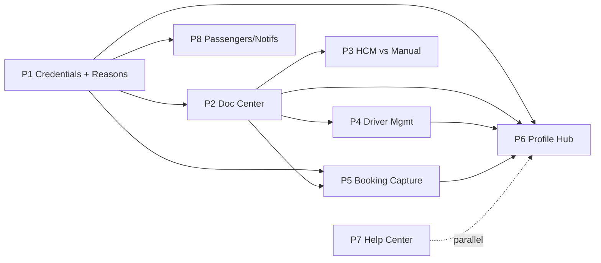

# Wayfinder Enhancement Program — Overview & Roadmap

**Owner:** Engineering + Product
**Status:** Plan (approved for build after review)
**Scope:** Employee/Driver credentials & documents, HCM-vs-manual source of truth, driver management, booking-flow hardening, actionable blocking reasons, self-service profile, and a help center.
**Related analysis (read first):**
- `docs/06-verification/gap-analysis-driver-licence-passenger-messaging.md`
- `docs/06-verification/critique-booking-and-employee-driver-lifecycle.md`

---

## 1. Why (problem statement)

The eligibility engine is fail-safe and well-built, but it depends on employee/driver data that has **no live source and no manual-entry surface**:

- **HCM sync is coded but never runs** (no scheduler, no endpoint, stub source returns empty), and the freshness gate blocks bookings after 24h (`hcm-data-stale`).
- **No manual capture** of licence / Emirates ID; **no Emirates ID field**, **no `person_document` table**, **no file-upload pipeline**.
- **`/me` does not expose credentials**, so the UI can't auto-fill, warn before expiry, or detect "missing → prompt."
- **Blocking reasons are masked** (specific reason swallowed behind a generic message; several codes untranslated).
- **Driver management** (professional-driver onboarding, assignment) has no first-class surface; `isProfessionalDriver` is a flag with no UI.
- **No employee profile page**, **no help center / FAQ**, **no in-app notification inbox**.
- **Passengers** are a count only (no identities).

## 2. North-star principles

1. **HCM-optional, manual-always.** The platform must be fully usable with HCM **off**. HCM is an *accelerator*, never a hard dependency.
2. **Single source of truth with provenance.** Every credential field records its `source` (`hcm | manual | seed`) and `verificationStatus`. Precedence is explicit and audited; verified manual data is never silently overwritten.
3. **Fail-closed on safety.** Missing/expired licence, expired vehicle docs, active blocks → block. Self-entered data is `Unverified` and never bypasses expiry blocks.
4. **Actionable, localized messaging.** Every block states the exact reason (EN/AR) and offers the remediation path (capture/refill) in place.
5. **Centralized employee documents.** One document store, surfaced consistently across booking, dedicated, driver, profile, and admin.
6. **Self-service first.** Employees see and fix their own eligibility, credentials, bookings, and approvals.

## 3. Phase roadmap

| Phase | Theme | Delivers | Depends on |
|---|---|---|---|
| **P1a** | Freshness fix + specific reasons (safe, no new blocks) | HCM-off skips staleness (**DONE**), most-specific block reasons + EN/AR, `/me/credentials` read | — |
| **P1b** | Credential data + fail-closed missing | Person credential fields + provenance, manual number/expiry entry, then enable `licence-missing` block (flagged) | P1a |
| **P2** | Employee Document Center | `person_document` + upload (reuse evidence-store port); reusable Document panel; surfaced in all modules | P1b |
| **P3** | HCM sync vs manual (source of truth) | Scheduled + admin-triggered sync, real adapter behind flag, precedence/merge + audit, sync health | P1b, P2 |
| **P4** | Driver management (onboarding & assignment) | Driver profile (licence/medical/training), onboarding wizard, assignment lifecycle, professional-driver register | P2 |
| **P5** | Booking flow hardening & inline capture | Real-scenario fixes; inline credential capture at consent; re-evaluate; remediable reasons | P1b, P2 |
| **P6** | Profile & self-service hub | `/me/profile` page: eligibility, credentials, documents, bookings, approvals/rejections, issues | P1–P5, P9 |
| **P7** | Help Center & FAQ | Dedicated help center, contextual help, FAQ content model | — (parallelizable) |
| **P8** | Passengers, notifications & cross-cutting | Passenger identities, in-app notification inbox + expiry reminders, reason catalog admin | P1a, P2 |
| **P9** | Driver accountability: fines, blocks & consent | Surface fines/tolls/black-points/blocks/consents to drivers; dispute + adjudicate; block explanation; re-consent | P1a, P2, P6 |

Delivery is incremental — each phase is independently shippable and leaves the app green. **Cross-cutting engineering standards for every phase are in `09-engineering-standards-and-integration.md`.**

## 3.1 Developer review — v2 additions & corrections

As the implementer, a review against the actual codebase surfaced gaps and reuse opportunities the first draft missed:

- **Driver-accountability pillar was absent (now P9).** The app already has a full fines lifecycle (`Recorded→Attributed→Disputed→Recovered→Closed`, auto-raising an access block on overdue black points), `access_block` + `raiseBlock`/lift, and consent records — but none of it is visible to the driver. This *is* the "see all my issues" requirement and was missing.
- **Reuse existing infrastructure (see `09`).** A private **evidence-store port + local disk adapter** already exists (handover) — reuse for document uploads instead of building storage from scratch. Azure Blob env config already present.
- **Prefer policy-driven requirements.** Route configurable rules (e.g. "Emirates ID required for grade ≥ X") through the **Policy Studio / `driver-eligibility-gate`** decision table, defaulting EID to **warn** — avoids mass-blocking and needs no deploy.
- **Adopt the app's write-path conventions everywhere** — idempotent commands, transactional outbox events, append-only audit, optimistic concurrency, RFC-7807 reason codes.
- **Symmetry & neighbours added to scope** — vehicle/vendor compliance holds, delegation of approvals, on-behalf/substitute-driver credential capture, bulk import of people/drivers/credentials (reuse MigrationModule), and compliance/expiry dashboards. See `01`/`02`.
- **P1 split into P1a/P1b** to avoid shipping a fail-closed block before capture UI exists (P1a step 1 — the freshness fix — is already implemented and green).

## 4. Dependency graph

## 5. Cross-cutting non-functional requirements

- **Security/PII:** Licence & Emirates ID are sensitive personal data. RBAC-scoped, excluded from safe read projections/logs, audited, retention-bounded. Uploads via short-lived private presigned URLs, path-scoped, size/type-limited.
- **i18n:** EN + AR (RTL) for every new string; no raw reason codes ever shown.
- **Gates:** typecheck (BE+FE), unit/integration tests, oxlint, `guard:contracts` (+`:update` for new DTOs), `guard:org` (allowlist new org-scoped files). Hand-authored Drizzle migrations + rollback.
- **Observability:** sync health, expiry counts, block-reason analytics.
- **Backward compatibility:** additive schema; existing bookings/entitlements unaffected.

## 6. Global acceptance (program-level "done")

- The full booking + dedicated + handover/return lifecycle can be completed with **HCM disabled**, using **manual** verified credentials.
- A first-time user with missing licence is **prompted in place**, provides details/files, and proceeds; next time it **auto-fills**; on expiry they are **forced to refill**.
- Every block shows a **specific, localized, actionable** reason with a remediation link.
- Employee documents are captured once and **appear consistently** across all modules.
- Drivers can be **onboarded and assigned** through a proper flow.
- Users have a **profile hub** and a **help center**.

## 7. Document index (this folder)

- `01-business-scenarios.md` — exhaustive scenario catalog + blocking matrix.
- `02-feature-inventory.md` — all features, priority (MoSCoW), phase mapping.
- `03-data-model-and-api.md` — schema, endpoints, provenance/source-of-truth, migrations.
- `phase-1-credentials-foundation-and-blocking-reasons.md`
- `phase-2-employee-document-center.md`
- `phase-3-hcm-sync-and-manual-source-of-truth.md`
- `phase-4-driver-management-onboarding-assignment.md`
- `phase-5-booking-flow-hardening-and-inline-capture.md`
- `phase-6-profile-and-self-service-hub.md`
- `phase-7-help-center-and-faq.md`
- `phase-8-passengers-notifications-and-cross-cutting.md`
- `phase-9-driver-accountability-fines-blocks-and-consent.md`
- `09-engineering-standards-and-integration.md` — app-specific patterns every phase must follow (reuse map, command/outbox/audit, policy-driven rules, RBAC/SoD, PII, flags).
