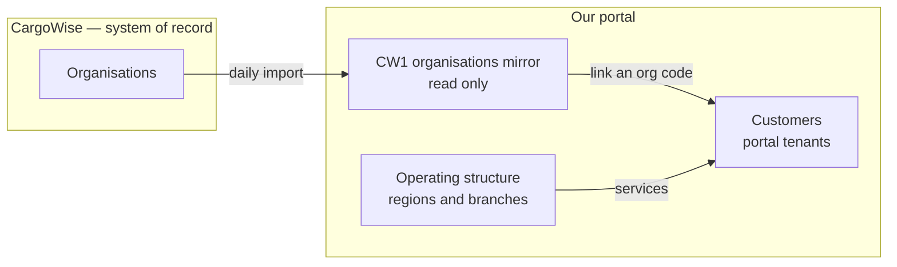
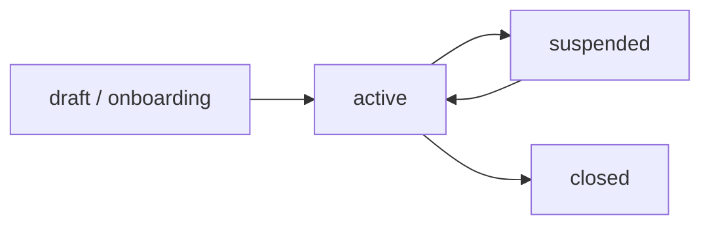
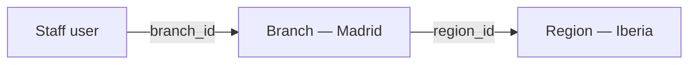
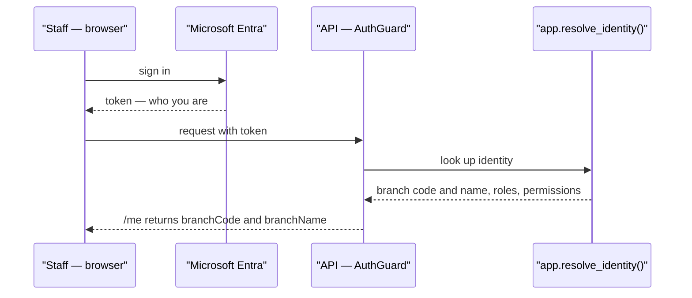
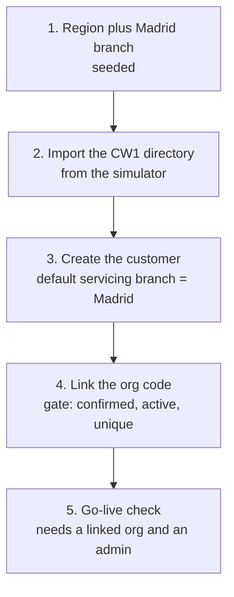

# Organisations, customers, branches and regions — what we have built

| Document control | Value |
| --- | --- |
| Date | 14.09.2026 |
| Purpose | Explain, for management, how organisation and customer linking works today, and where regions and branches fit |
| Audience | Product owner, delivery manager, pilot sponsor |
| Status | Describes the current implementation. Verified against source on 14.09.2026 |
| Companion | [Org-Customer-Branch-Region-Slides.html](Org-Customer-Branch-Region-Slides.html) — the same content as slides for a management walkthrough |

> Scope note. This describes what is implemented in the portal today, and states plainly what is still pending. A menu or a screen existing is not the same as the end-to-end journey being ready; both are called out below.

---

## 1. The three lists we keep separate

The portal deliberately keeps three separate lists and never mixes them.

1. **CW1 organisations** — a read-only mirror of every company CargoWise knows (customers, suppliers, carriers, agents). We copy it in and never edit it.
2. **Customers** — the companies we onboard into the portal. This is the portal tenant, and it is ours, not CargoWise's.
3. **Noatum operating structure** — our own regions and branches, meaning the offices we work from.

**Linking** is the one deliberate action that connects list 1 to list 2: "these CargoWise organisation codes belong to this customer."

---

## 2. Linking, and the safety gate

When we onboard a customer we search the imported CargoWise directory and attach the organisations that belong to them. The rules are:

- **Organisation level only.** We link a whole organisation, never a single address beneath it.
- **One organisation belongs to exactly one customer.** The same code can never be linked to two customers.
- **One customer can hold many organisations.** For example three offices of one retail group all link to that one customer.
- **Only confirmed, active organisations can be linked.** An organisation that no source run has confirmed cannot be attached at all.

The last two rules are enforced **by the database**, not just by application code. The link is a foreign key that only accepts a source-confirmed organisation, so a wrong link cannot be created even by accident. The attach screen shows the reason an organisation is blocked — already linked, not yet confirmed, or inactive.

Source: [customers.service.ts](../../apps/noatum-customer-portal-api/src/modules/customers/customers.service.ts) · [organisation directory migration](../../apps/noatum-customer-portal-api/prisma/migrations/20260915000000_organisation_directory/migration.sql)

---

## 3. The customer lifecycle and go-live

A customer moves through clear states, and going live is **refused**, not merely warned, until the customer is usable.

**Go-live readiness** needs two things, and the system names whatever is missing:

- at least one linked, active organisation, and
- at least one invited administrator.

Source: [customers.controller.ts](../../apps/noatum-customer-portal-api/src/modules/customers/customers.controller.ts)

---

## 4. Where regions and branches come in

There is no region field on a staff member. The link is a chain: a person points at one branch, and the branch points at one region.

- **Branch** is a Noatum office. It is where an employee works, and it scopes the pricing queue.
- **Region** is a grouping of branches. Today it only groups; region-level policy rules are still an open decision.

So "one region, one Madrid branch" is set up as data: create region Iberia, create branch Madrid inside it, and point staff at the Madrid branch. Adding a second region or branch later is configuration — new rows — not a code change. That is the core promise: one region now, any region by configuration.

Source: [operating regions and branches migration](../../apps/noatum-customer-portal-api/prisma/migrations/20260912050000_operating_regions_and_branches/migration.sql) · [schema.prisma](../../apps/noatum-customer-portal-api/prisma/schema.prisma)

---

## 5. How and where we identify a staff member's branch

### Where a human sets it

**Administration → Staff users → edit a person.** The drawer has an **Operating branch** dropdown next to the roles. The dropdown lists active branches only. When saved, the server enforces the rules:

- a pricing role cannot be granted without a branch,
- an inactive or unknown branch is refused,
- the change is recorded in the audit trail, before and after.

The region is never chosen here. It rides along with the branch.

Source: [StaffPage.tsx](../../apps/noatum-customer-portal-ui/src/features/staff/pages/StaffPage.tsx) · [users.service.ts](../../apps/noatum-customer-portal-api/src/modules/users/users.service.ts)

### How the portal knows it on every request

At sign-in, the identity lookup joins the branch and returns the branch code and name. That travels into the request context and is returned by the `/me` endpoint, so every request the staff member makes already carries "I am Madrid." The region is not carried at runtime; it is looked up through the branch only when needed for display.

Source: [resolve_identity migration](../../apps/noatum-customer-portal-api/prisma/migrations/20260912060000_resolve_identity_roles_and_branch/migration.sql) · [current-user.dto.ts](../../apps/noatum-customer-portal-api/src/contracts/dto/current-user.dto.ts)

---

## 6. The detail that causes confusion: "branch" means two things

The word branch is used for two different things. In the pilot both are Madrid, which is why it looks like one thing.

| Field | Meaning | Used for |
| --- | --- | --- |
| **Staff branch** | The office an employee works from | Scopes the pricing queue |
| **Servicing branch** on a customer link | The office that services a customer's linked organisation | Says which office looks after that customer, falling back to the customer default |

They are separate fields with separate meanings. The staff branch is "where the employee sits." The servicing branch is "who looks after this customer."

---

## 7. The "one region, one customer" demo path

This is the internal, staff-side journey, and it works end to end today.

---

## 8. What is implemented, and what is pending

| Area | Built today | Pending |
| --- | --- | --- |
| CW1 directory | Import with provenance, active state, roles, addresses, run history | Real CargoWise feed — the directory is fed by the simulator today |
| Customer records | Create, edit, two-level parent and child, tier, email domains, lifecycle | — |
| Org to customer linking | Attach and detach with a reason, database-enforced gate, one org one customer | Per-link servicing branch is not yet chosen in the attach screen; it falls back to the default |
| Go-live | Refused until a linked organisation and an admin exist, and it names what is missing | — |
| Regions and branches | Modelled and seeded; staff carry a branch; branch is read on every request | Branch and region editing screen — the current screen is read-only |
| Staff branch identification | Set on the Staff users screen, enforced for pricing, carried through `/me` | The branch-scoped pricing queue that consumes it is later Phase 1 work |
| Customer sign-in | Invitations are created and emailed | The customer clicking the link, signing in through Entra External ID and being bound is not wired yet |
| Shipments and invoices becoming visible after a link | — | Phase 2 — the visibility payoff arrives with the shipment modules |

---

## 9. What to say to management

> We model three separate things: the CargoWise organisation directory that we mirror read-only, the customer we onboard, and our own operating structure of regions and branches. Onboarding a customer is import the directory, create the customer, then link their CargoWise organisation codes — one code to one customer, and only organisations CargoWise has confirmed. The database enforces that link, so it cannot be done wrong.
>
> A staff member is tagged with one branch on the Staff users screen, and the region is whatever that branch belongs to. The portal reads the branch on every sign-in and carries it through `/me`. Region is just the grouping above branch. Note that branch means two things — where the employee works, and which office services a customer — and in the pilot both are Madrid.
>
> For the pilot, one region and one customer is set up as data. Adding a second region or customer later is configuration, not new code. Today's demo is the internal onboarding journey. Two things are deliberately still pending: the customer's own Microsoft login, and the live CargoWise feed, which the simulator stands in for.
